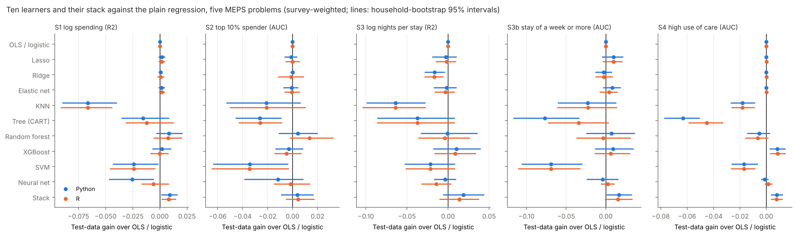
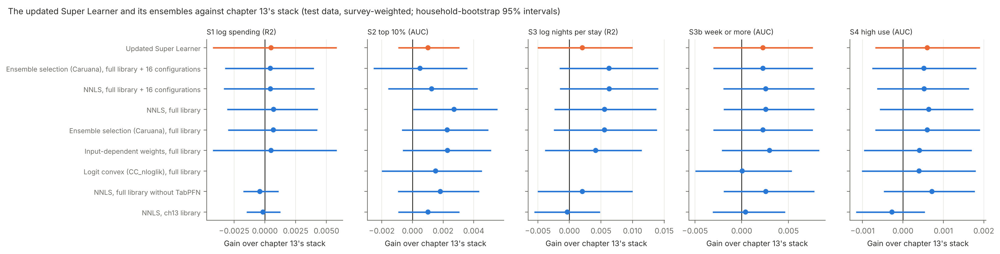

# Using MEPS data for machine learning: a walkthrough

Eliot R. Weinstein · November 2026

This is the machine learning half of the guide. The first half
([`WALKTHROUGH.md`](WALKTHROUGH.md)) uses MEPS as the population in simulation
studies. This half uses the same survey to show how to fit, compare and explain
the most common kinds of machine learning models, following the chapters of
three textbooks:

- *An Introduction to Statistical Learning*, 2nd ed. (James, Witten, Hastie and
  Tibshirani 2021; "ISLR"), and its Python edition (James, Witten, Hastie,
  Tibshirani and Taylor 2023; "ISLP"), which have the same chapters;
- *The Elements of Statistical Learning*, 2nd ed. (Hastie, Tibshirani and
  Friedman 2009; "ESL");
- *Interpretable Machine Learning*, 3rd ed. (Molnar 2025; online at
  christophm.github.io/interpretable-ml-book).

It adds what those books do not cover: stacking and the Super Learner, conformal
prediction intervals, subgroup checks, methods from the last four years for
tabular data (TabPFN, RealMLP, TabM), a chapter that comes back to
simulation and trial design (adjusting a trial's analysis for a machine-learning
prognostic score), one that lines up ten learners and their stack on five
problems, including length of hospital stay and a fairness check, and a last one
that updates the Super Learner with what the last few years of stacking research
recommend. Every chapter has an R script and a Python script that use
exactly the same rows, folds and test set, so the numbers can be compared.

As in the first half, the numbers below are what we got with the 2023 release
of the files, shown so you know what to expect. The data are not part of the
repository (see "Using the MEPS data responsibly" in the README).

Contents

0. How this half connects to the first
1. The prediction problem and the data set
2. Running the code
3. How the models are judged
4. The chapters
5. All results in one table
6. Methods from the last four years, and what we left out
7. Lessons and cautions
8. References

---

## 0. How this half connects to the first

The simulation half treats MEPS as a population to sample from. Machine learning
uses it as a population to *predict*: who will be a high spender next year, who
will go to an emergency room, how many office visits someone will have. The two
meet in three places, which is why they share a repository:

- **Realistic outcomes break models in instructive ways.** Spending's lump at zero
  and long tail, which made the textbook distributions misleading in the
  simulation half, also make the obvious regression models misleading here
  (chapter 1's log-OLS-with-smearing prediction is off by a factor of eight).
- **Fitted models make better simulation populations.** A plasmode simulation
  that needs a known "truth" can take it from a model fitted to the real data
  (Franklin et al. 2014); the better the model, the more realistic the truth.
- **Predictions shrink trials.** Chapter 12 uses a prognostic score from the
  machine learning chapters to cut the sample size a simulated trial needs by
  about half, and checks the planning formula against simulation. This is the
  same question as the pilot-study work the guide grew out of, approached from
  the other side: instead of estimating the outcome's variance better, we
  explain more of it.

## 1. The prediction problem and the data set (`ml/R/ml_00_extract.R`, `ml/python/ml_00_extract.py`)

### 1.1 A prospective design

A model that predicts this year's spending from this year's visits and
diagnoses learns little: the visits *are* the spending. Health plans,
Medicare's risk adjustment and most of the research literature instead predict
**next** year from **this** year. MEPS's two-year longitudinal files follow the
same people for two years, so we use **Panel 27** (HC-252: people who entered
MEPS in 2022 and were followed through 2023):

- **predictors from 2022:** age, sex, race and ethnicity, region, marital
  status, education, family income relative to poverty, insurance (including
  Medicare and Medicaid), employment, having a usual source of care,
  self-rated physical and mental health, 12 chronic conditions, functional
  limitations, BMI, the SF-12 physical and mental component scores and the
  PHQ-2 and K6 screens from the self-administered questionnaire, and 2022 use
  and spending (total and
  out-of-pocket spending, office visits, ER visits, hospital stays and
  prescriptions);
- **outcomes from 2023:** total spending (`cost`), log(1 + spending)
  (`log_cost`), being in the top 10% of spenders (`high_cost`; the cut-off was
  $20,030), any ER visit (`any_er`), any hospital stay (`any_ip`), and the
  number of office-based visits (`ob_visits`).

The data set has **6,353 adults** (18 or older at the end of 2022, in scope for
all five interview rounds, with a positive longitudinal weight) and 59 columns.

### 1.2 Train and test sets that the two languages share

People in the same household have correlated spending, so households are kept
together: 30% of households (1,879 adults) are the **test set**, and the rest
are split into five **cross-validation folds**. Both are fixed by a formula of
the household ID, not by a random number generator, so R and Python get exactly
the same split:

```r
u      <- ((household * 7919 + 104729) %% 1000003) / 1000003
test   <- u < 0.3
fold   <- floor(((household * 15485863 + 32452843) %% 999983) / 999983 * 5) + 1
```

All tuning (penalties, tree depths, numbers of boosting rounds, network sizes)
uses only the folds of the training households. The test set is touched once
per model, at the end.

### 1.3 Missing values

MEPS's negative codes (−1 inapplicable, −7 refused, −8 don't know, and so on)
become missing. Numeric predictors are filled with the training-set median and
get a `_miss` indicator when more than 1% are missing; categorical predictors
get a "Missing" level. This is simple and transparent, and it lets every model
use every person. Multiple imputation, or letting tree models handle missing
values themselves (xgboost, LightGBM and CatBoost all can), are alternatives;
for prediction, as opposed to estimating coefficients, the simple approach
usually costs little (Josse et al. 2024).

### 1.4 A version you can show someone

`data/meps_ml.csv` is plain text with one row per adult and readable column
names, and `data/README.md` describes every column. For a quick look without R
or Python, `R/13_review_workbook.R` writes a spreadsheet with a description of
each extract, the variable list and summary statistics. Neither file may be
posted or shared beyond the people you work with: they are made from MEPS
public use files, which AHRQ's data use agreement does not let you
redistribute (the workbook says so on its first sheet).

## 2. Running the code

The scripts are in `ml/R/` and `ml/python/`, numbered by chapter, and are run
from the repository's top folder (in RStudio, open `meps_for_simulation.Rproj`
first):

```r
source("ml/R/ml_00_extract.R")      # once; needs h252.dta (see WALKTHROUGH.md, section 2)
source("ml/R/ml_01_classical.R")    # and so on through ml_12
```

```bash
python ml/python/ml_00_extract.py   # makes the same data/meps_ml.csv
python ml/python/ml_01_classical.py
```

Chapter 13 has its own extract (`ml_13a_stays_extract`), which needs the
2021–2023 stay, condition-link, condition and full-year files listed in its
header.

`ml_common.R` and `ml_common.py` hold the shared pieces: reading the data, the
predictor list, the design matrix, the survey-weighted metrics, and a function
that appends each model's test results to `output/ml/results_R.csv` or
`output/ml/results_python.csv` (rerunning a chapter replaces its own rows).

**Packages.** R: glmnet, mgcv, FNN, rpart, ranger, xgboost, e1071, nnet,
cluster, SuperLearner, glm2, quadprog, ggplot2, patchwork. Python: numpy, pandas,
statsmodels, scikit-learn, pygam, xgboost, lightgbm, torch, shap, tabpfn,
pytabkit and catboost. Most chapters run in a minute or two on a laptop. The
slow ones are the support vector machines (chapter 5), the neural networks'
tuning (chapter 6, 20–40 minutes), the Super Learner (chapter 8, about 15
minutes), and TabPFN on a CPU (chapter 11; about an hour for four outcomes on two
cores; much faster on a GPU). RealMLP, TabM and CatBoost (chapter 11b) take about
ten minutes. Chapter 13 takes about 35 minutes in Python and two hours in R for
all five problems (most of it the random forests, SVMs and neural networks, and
the permutation importance of the stack). Chapter 14 takes about half an hour
without TabPFN; TabPFN on a CPU added 17–33 minutes per problem.

## 3. How the models are judged

**Survey-weighted test metrics.** MEPS is a complex sample: some groups are
oversampled, and each person carries a weight saying how many US adults they
stand for. A model's error on the test set is an estimate of its error in the
population only if the test people are weighted, so every metric is a weighted
average over test people (with the longitudinal weight, `LONGWT`):

- for continuous outcomes, RMSE, mean absolute error and R² (one minus the
  weighted mean squared error over the weighted variance);
- for binary outcomes, the area under the ROC curve (AUC; the weighted
  probability that a random case is ranked above a random non-case), the
  Brier score and the log loss;
- for counts, the Poisson deviance as well as R².

**Weights for judging, not necessarily for fitting.** Chapter 1 fits the
logistic model for `high_cost` and the OLS model for `log_cost` both with and
without the weights. Unweighted fits did slightly better on the weighted test
metrics (AUC 0.815 vs 0.812; R² 0.487 vs 0.478). When the goal is prediction,
weights in fitting buy robustness to a misspecified model at the cost of
variance, and here the variance won. The other chapters fit without weights
and evaluate with them.

**How sure can we be?** With 1,879 test people in 1,155 households, test
metrics are estimates with real uncertainty. Chapter 8 resamples test
**households** 2,000 times. The 95% interval for the Super Learner's R² for
2023 spending is 0.11 to 0.33 in R (0.14 to 0.36 in Python): almost every
model's R² for spending lies inside it. Differences between two models on the
same test people are more precise than either model's metric, because the
noise is shared, so the bootstrap is also run on the difference (section 4.8).

## 4. The chapters

Each chapter below lists the textbook sections it follows, what the scripts do,
and what we found. The R and Python scripts have the same names, except where
noted.

### 4.1 Baselines and classical regression (`ml_01_classical`; ISLR ch. 3–4, ESL ch. 3–4)

The mean of the training data, linear and logistic regression, Poisson and
negative binomial regression for visit counts, and the health economist's
standard models for spending (Deb and Norton 2018; Mihaylova et al. 2011):

- **log OLS with Duan's smearing.** Fit OLS to log(1 + spending), predict, take
  exp, and multiply by the mean of exp(residuals). **R² = −61.** The smearing
  factor was 13.1: 16% of adults (weighted) had no spending in 2023, and the
  log-scale residuals of people who went from little or nothing in 2022 to a
  lot in 2023 are so large that their exponentials dominate the mean. The predicted mean spending was $60,900
  against an actual $7,700. Smearing assumes the residuals have the same
  distribution for everyone; with a lump at zero they do not.
- **a two-part model** (logistic for any spending × gamma GLM with a log link
  for the amount if any): R² 0.19.
- **a GLM with a log link** fitted by quasi-Poisson (Manning and Mullahy
  2001): R² **0.235**, which turned out to be about as good as anything in the
  later chapters.

Two practical notes. The gamma GLM's usual fitting algorithm (IRLS) did not
converge from its default start, oscillating at a worse deviance; R's `glm2`
(step-halving; Marschner 2011) from OLS-on-log starting values fixed it, and
Python's statsmodels needed Newton's method from the same start. And the
logistic regression for `high_cost` (AUC 0.815) is the classifier every later
model has to beat.

### 4.2 Shrinkage: ridge, lasso and the elastic net (`ml_02_regularization`; ISLR ch. 6, ESL sec. 3.4 and 4.4.4)

Penalties chosen by cross-validation over the household folds (glmnet's
`foldid` in R; scikit-learn's `PredefinedSplit` in Python). With 6,353 people
and 71 columns, shrinkage changes little (log spending R² 0.489 vs 0.487 for
OLS), which is itself the lesson: penalties pay off when predictors are many
relative to people.

What the lasso keeps is more interesting than what it predicts. At the
penalty that minimizes cross-validated error it kept 48 of 71 columns for log
spending; at the "one standard error" penalty, 22. For raw dollars it kept 26
at the minimum and **none** at the one-standard-error rule: with squared error
on a long-tailed outcome, the cross-validated error is so noisy that a model
with no predictors is within one standard error of the best. (In Python,
scikit-learn has no Poisson lasso, so the visit-count model there is ridge
only.)

### 4.3 Beyond linearity: GAMs and nearest neighbours (`ml_03_nonlinear`; ISLR ch. 7 and sec. 2.2, ESL ch. 5, sec. 9.1 and ch. 13)

Generalized additive models with penalized regression splines for the
continuous predictors (mgcv in R, smoothness chosen by REML; pygam in Python)
and k-nearest neighbours on standardized predictors.

The GAMs matched the linear models (log spending R² 0.486–0.490; `high_cost`
AUC 0.816–0.822) — the relation with the strongest predictor, 2022 spending, is
already close to linear on the log scale. KNN was the weakest method that
ran without trouble (R² 0.42, AUC 0.78): with 70 dimensions, many of them
binary, "near" means little.

Python's Poisson GAM for spending diverged until the outcome was divided by
1,000 and its penalty chosen by household-fold Poisson deviance; R's Tweedie
GAM converged but predicted poorly (R² 0.11). Spending in dollars is hard on
iterative fitting algorithms.

### 4.4 Trees, random forests and boosting (`ml_04_trees_ensembles`; ISLR ch. 8, ESL sec. 9.2 and ch. 10, 15)

A single tree pruned by cross-validation (cost complexity), a random forest
(ranger in R, scikit-learn in Python; `mtry` from a small grid), and gradient
boosting (xgboost in both, plus LightGBM in Python) with shallow trees, a
learning rate of 0.03, subsampling, and the number of rounds chosen by early
stopping on the household folds.

Two choices matter more than the library:

- **The loss should match the outcome.** For spending in dollars, boosting with
  squared error got R² 0.10–0.15; with a **Tweedie** loss (a point mass at zero
  plus a continuous tail; Yang, Qian and Zou 2018) it got **0.23–0.25**. For
  visit counts the Poisson loss is the natural one.
- **Pruning can remove everything.** R's cross-validated tree for any ER visit
  and any hospital stay (outcomes with 10–15% prevalence) was pruned to a single
  node, giving AUC 0.5: rpart's cross-validated error counts misclassifications,
  and predicting "no" for everyone is hard to beat on that count. Python's tree,
  pruned by cross-validated log loss, kept its splits (AUC 0.67).

The random forest was the best single classifier for `high_cost` in both
languages (AUC 0.823–0.825). The fitted boosting models are saved for chapter
9.

### 4.5 Support vector machines (`ml_05_svm`; ISLR ch. 9, ESL ch. 12)

Linear and radial-kernel SVMs for the binary outcomes (probabilities by Platt
scaling) and support vector regression for log spending, on standardized
predictors, cost and kernel width from a grid. They were among the weakest
models here (`high_cost` AUC 0.78; any ER visit 0.54–0.66, against 0.76 for
logistic regression) and the slowest to tune. SVMs were designed for
separating classes with a margin, not for probabilities of rare outcomes; they
are included because both textbooks give them a chapter, and to show where they
stand on data like these.

### 4.6 Neural networks (`ml_06_neural_nets`; ISLR ch. 10, ESL ch. 11)

A network with one hidden layer and weight decay (nnet in R, scikit-learn's
MLP in Python), with the size and decay chosen on the household folds and each
fit averaging five random starts (ESL sec. 11.5); in Python, also a deeper
network in PyTorch (two hidden layers, ReLU, dropout, AdamW, early stopping),
the kind ISLP's deep-learning lab builds. Spending is modelled on the log scale
only.

The one-hidden-layer network matched logistic regression (`high_cost` AUC
0.812 in both languages; any ER visit 0.762 in R and 0.772 in Python, the best
for that outcome in Python). The deeper
network was worse on every outcome (log spending R² 0.457 vs 0.482). With six
thousand people and mostly binary predictors, a deep network has little to find
that a GLM has not, and more ways to overfit. Section 6 covers the newer
networks designed for tabular data.

### 4.7 Unsupervised learning (`ml_07_unsupervised`; ISLR ch. 12 and sec. 6.3, ESL ch. 14)

Principal components of 18 health measures (the first component is overall
poor health: every loading points toward worse health), k-means and Ward hierarchical
clustering on the leading components plus 2022 spending, and principal
components regression.

The four k-means clusters are easy to describe and line up with 2023 spending,
which the clustering never saw: a large healthy group (69% of adults; mean 2023
spending $4,700, 5% in the top 10%), a middle-aged group with poor self-rated
health (9%; mean age 46, 38% in fair or poor health; $12,400), an older group with chronic conditions (20%;
$16,700) and a small group with serious functional limitations (2%; $25,700,
38% in the top 10%). Principal components regression with 38 components
(chosen by cross-validation) got R² 0.475, a little below OLS: the directions
of greatest variation in the predictors are not the ones that predict spending
best (ISLR sec. 6.3.1).

### 4.8 Stacking and the Super Learner (`ml_08_stacking`; ESL sec. 8.8 and ch. 16)

Stacked generalization (Wolpert 1992; Breiman 1996) combines several models'
predictions; the Super Learner (van der Laan, Polley and Hubbard 2007) is the
version with a theory behind it: with cross-validated predictions and a
suitable combining step, it does asymptotically as well as the best
combination of its candidates. The scripts do it in the open:

1. fit each learner (the mean; a GLM; the lasso; a random forest; boosting with
   the outcome's loss) on four household folds and predict the fifth, so every
   training person gets an out-of-fold prediction from every learner;
2. the **discrete** Super Learner picks the learner with the smallest
   cross-validated risk;
3. the Super Learner proper finds non-negative weights, summing to one, that
   minimize the out-of-fold squared error (or log loss for `high_cost`);
4. refit each learner on all the training data, and combine with those weights.

R uses the `SuperLearner` package (`method.NNLS`, and `method.NNloglik` for the
binary outcome); Python writes the steps out, and also shows scikit-learn's
`StackingRegressor`.

The weights are informative. For spending in dollars, the Tweedie boosting
model got 94–96% of the weight; for log spending, the weight was spread over
the GLM, random forest and boosting, which make different mistakes.

The household bootstrap of the test set shows what the Super Learner bought:

| Outcome (metric) | Super Learner | Best single learner | Difference (95% interval) |
|---|---|---|---|
| log spending (R²) | 0.496 (0.447–0.541) | random forest 0.493 | 0.004 (−0.004 to 0.011) |
| spending (R²) | 0.237 (0.106–0.334) | quasi-Poisson GLM 0.235 | 0.002 (−0.064 to 0.074) |
| top 10% (AUC) | 0.815 (0.773–0.857) | random forest 0.823 | −0.008 (−0.020 to 0.004) |

(R; Python's are close, see `output/ml/test_bootstrap_python.csv`.) Nothing
that a reader of a paper would call a difference. The Super Learner's promise
is to do as well as the best learner without your knowing in advance which
that is, and that is what it did; it did not beat the best learner, and on a
test set of this size it could not have shown that it had.

### 4.9 Interpreting a black box (`ml_09_interpretation`; Molnar ch. 13, 17–20 and 23)

For the boosting model of being a top-10% spender, with the logistic
regression alongside:

- **permutation importance** (Molnar ch. 23): the loss in weighted test AUC when
  one predictor is shuffled (dummies of one categorical variable shuffled
  together). 2022 spending dominates (AUC falls by 0.10–0.12); age and 2022
  prescriptions come next, at about 0.01;
- **partial dependence and ICE curves** (ch. 19 and 13), and **accumulated local
  effects** (ch. 20), which avoid averaging over impossible combinations of
  correlated predictors (2022 spending with zero 2022 visits);
- **SHAP values** (ch. 17–18), exact for trees (TreeSHAP; Lundberg et al. 2020):
  the same ordering, then mental health (MCS, PHQ-2), high blood pressure and
  physical functioning.

Two lessons. Importance from the GLM's coefficients and from SHAP disagree on
the correlated predictors (the 2022 use and spending variables share
credit differently), and neither is "the" importance: they answer different
questions. And none of these is causal: a large SHAP value for prescriptions
says the model leans on them, not that prescriptions cause spending.

The figures (`output/ml/fig_*`) show individual people's predictions, so they
stay out of the repository with the data.

### 4.10 Prediction intervals and subgroups (`ml_10_uncertainty_subgroups`)

**Conformal prediction** (Vovk, Gammerman and Shafer 2005; Lei et al. 2018;
Angelopoulos and Bates 2023) turns any model into prediction intervals with
guaranteed coverage, on average over people exchangeable with the calibration
set. Training on folds 1–4 and calibrating on fold 5, 90% intervals for log
spending:

| Group | Split conformal | CQR | CQR by insurance | Quantile boosting alone |
|---|---|---|---|---|
| All | 0.88 | 0.91 | 0.90 | 0.88 |
| Any private | 0.88 | 0.89 | 0.89 | 0.86 |
| Public only | 0.91 | 0.92 | 0.93 | 0.90 |
| Uninsured | 0.83 | 0.97 | 0.87 | 0.93 |
| Age 18–44 | 0.83 | 0.91 | 0.89 | 0.87 |
| Age 65+ | 0.96 | 0.91 | 0.91 | 0.89 |
| Top 10% in 2023 | 0.89 | 0.65 | 0.67 | 0.61 |

(R; coverage on the test set.) Split conformal adds the same width to
everyone, so it over-covers the old and under-covers the young.
**Conformalized quantile regression** (CQR; Romano, Patterson and Candès 2019)
lets the width depend on the person and gets close to 90% in most groups.
Calibrating separately within insurance groups ("Mondrian" conformal) guarantees
coverage within each group. None of them covers next year's top spenders: the
guarantee is marginal, and a group defined by the outcome itself is exactly
where a marginal guarantee says nothing. Gibbs, Cherian and Candès (2025)
extend conformal guarantees to groups and shifts defined by the predictors, not
by the outcome.

**Subgroups.** The top-10% classifier's AUC and calibration (observed share
over predicted share), by insurance, race and ethnicity, and age:
calibration ranged from 0.78 for Black adults and 0.79 for the uninsured
(the model over-predicts their chance of being top spenders) to 1.27 for Asian
adults, with 0.60 for the small "other or multiple races" group (61 people).
These are point estimates on small groups; but a model that will be used to
allocate care or outreach should be checked like this, and calibrated within
groups if needed (Obermeyer et al. 2019 show what goes wrong when the outcome
predicted, spending, is a poor stand-in for the need it is used to measure).

### 4.11 Recent tabular models (`ml_11_tabpfn.py`, `ml_11b_realmlp_tabm_catboost.py`; Python only)

See section 6.

### 4.12 Back to trials: adjusting for a prognostic score (`ml_12_prognostic_adjustment`)

In a randomized trial, adjusting the analysis for a baseline covariate that
predicts the outcome (ANCOVA) leaves the treatment estimate unbiased and cuts
its variance by about (1 − R²), R² being the squared correlation of covariate
and outcome. **PROCOVA** (Schuler et al. 2022) uses a machine-learning
prediction from historical data as that covariate; the European Medicines
Agency qualified it in 2022 for continuous outcomes in phase 2 and 3 trials.
Randomization does the work for unbiasedness, so the model can be anything;
its quality only buys precision.

A plasmode simulation: the training households are the "historical data", the
test households the trial population. Each simulated trial draws 2 × 300
adults, randomizes them, and lowers the treated arm's log(1 + 2023 spending)
by 0.5. 5,000 trials with the effect and 5,000 without:

| Analysis | R² | Variance ratio (simulated) | 1 − R² | Power (simulated) | Power (formula) | Type I error | n per arm for 80% |
|---|---|---|---|---|---|---|---|
| Difference in means | — | 1.00 | 1.00 | 0.46 | 0.47 | 0.054 | 659 |
| ANCOVA, 2022 log spending | 0.455 | 0.55 | 0.55 | 0.71 | 0.73 | 0.053 | 360 |
| ANCOVA, lasso score | 0.522 | 0.48 | 0.48 | 0.77 | 0.78 | 0.056 | 316 |
| ANCOVA, boosting score | 0.530 | 0.47 | 0.47 | 0.78 | 0.79 | 0.054 | 310 |
| ANCOVA, both scores | 0.531 | 0.47 | 0.47 | 0.78 | 0.79 | 0.055 | 309 |

(R; Python's are within simulation error.) Three things to take from it:

1. The (1 − R²) shortcut predicted the simulated variance ratio and power
   closely, so the sample size for an adjusted trial can be planned from an
   estimate of R², the same way it is planned from an estimate of the SD. (That
   estimate of R² is itself uncertain, the same problem the pilot-study work
   studies for the SD; `pilotplan`'s `v_cluster_mean` treats it for cluster
   means.)
2. **Most of the gain came from the simplest covariate.** Last year's spending
   alone halved the variance; the machine-learning scores took it from 0.55 to
   0.47, about 50 people per arm. Worth having, but the prior-year outcome is
   where most of the information is.
3. Type I error stayed near 5% (0.053–0.056; the simulation's standard error is
   0.003), as theory says it should with any fixed score.

### 4.13 Ten learners side by side (`ml_13_model_comparison`, data from `ml_13a_stays_extract`)

The earlier chapters take one family of models at a time. Applied papers more
often line up many learners on one problem and show, for each, its predictions
in the training data and in held-out data, then explain the winner. Stata's
`pystacked` (Ahrens, Hansen and Schaffer 2023) made that layout easy: a set of
base learners, a stack of them, a grid of predicted-against-observed plots with
each learner's stacking weight in its title, and a variable importance plot for
the best model. Zeleke et al. (2023) did the same for length of stay with eight
regressors and six classifiers, adding ROC and calibration curves. This
chapter does it for five MEPS problems on three data sets, in R and Python.

**The problems.**

| | Outcome | Data | Training / test | Metric |
|---|---|---|---|---|
| S1 | log(1 + 2023 spending) | Panel 27 adults (chapter 1's data) | 4,474 / 1,879 | R² |
| S2 | top 10% of 2023 spenders | the same | 4,474 / 1,879 | AUC |
| S3 | nights per hospital stay (log) | stays of adults admitted 2021–2023 | 3,984 / 1,590 stays | R² |
| S3b | a stay of a week or more | the same | 3,984 / 1,590 | AUC |
| S4 | "high use" of care in 2023 | 2023 full-year file, adults | 10,354 / 4,414 | AUC |

**S3, the length-of-stay data** (`ml_13a`). MEPS's hospital stay files have
the nights in hospital, whether the stay began in the ER, the reason (an
operation, other treatment, tests only, giving birth, a pregnancy
complication), and whether there was an operation, but no diagnosis-related
group. The diagnoses come the long way round: the condition-event link file
ties each stay to the conditions the household reported for it, and the
conditions file gives each condition's CCSR categories, whose first three
letters are a body system (circulatory, respiratory, infections, and so on),
the survey's stand-in for a Major Diagnostic Category. The person's
characteristics come from that year's full-year file. Left out on purpose:
payments (known only after discharge, and they rise with the nights), discharge
medicines, and the person's other use in the year (it includes this stay).
Three years are pooled to get 5,574 stays; the median is 3 nights, and 19%
last a week or more.

One trap: **a year's stay file holds the stays that ended that year**. The 11
stays in the 2023 file that began in 2022 averaged 26 nights, against 5 for the
rest, because a stay begun in December only reaches the next year's file if it
is long. A first version used "began the year before" as a predictor, and it
came fifth in importance: length-biased sampling, not something known at
admission. Stays are now counted by the year they began.

**S4, high use** (`ml_13a`) follows IBM's AI Fairness 360 MEPS example
(Bellamy et al. 2019): ten or more office, outpatient and ER visits, inpatient
nights and home health visits in the year, with race and ethnicity
(non-Hispanic White vs everyone else) as the "protected attribute". The
predictors are the same year's characteristics, as in that example. 28% of
adults were high users (weighted): 35% of non-Hispanic White adults and 18% of
others.

**The learners.** Ten, plus their stack, the same in both languages except for
the libraries:

| Learner | Tuned on the household folds | R | Python |
|---|---|---|---|
| OLS / logistic regression | — | `lm`, `glm` | scikit-learn |
| Lasso, ridge, elastic net | penalty (and mixing for the elastic net) | `glmnet` | scikit-learn |
| k nearest neighbours | k | `FNN` | scikit-learn |
| A single tree (CART) | depth, leaf size | `rpart` | scikit-learn |
| Random forest | share of variables per split, node size | `ranger` | scikit-learn |
| Gradient boosting | rounds, depth | `xgboost` | `xgboost` |
| Support vector machine (RBF kernel) | cost | `e1071` | scikit-learn |
| Neural network | weight decay (and size in R) | `nnet`, one layer, three starts averaged | two layers (32, 16) |
| Stack | non-negative weights summing to one | `quadprog` | `scipy` |

The stack is `pystacked`'s default ("nnls1"): non-negative least squares on
the out-of-fold predictions, with the weights summing to one. For the yes/no
outcomes, the SVM's scores become probabilities by Platt scaling of its
out-of-fold scores.

**The plots** (in `output/ml/ch13/`, and those that do not show individuals in
`docs/ml/`):

- `fig13_S*_in_sample.png` and `fig13_S*_out_of_sample.png`: the capstone-style
  3 × 4 grids. For the continuous outcomes, predicted against observed with
  the line of equality, one panel per learner, the stacking weight in the title
  (training data, then test data). For the yes/no outcomes, ROC curves in the
  same layout. The scatter grids show individual people, so they stay in
  `output/`.
- `fig13_S*_metrics.png`: each learner's R² or AUC in the training data, by
  cross-validation, and in the test data with a household-bootstrap interval.
  The gap between the open circle (training) and the filled one (test) is the
  overfitting the in-sample grid shows by eye.
- `fig13_S*_vip.png`: permutation importance for the best model on the test
  data (and for the best single learner, when the best model is the stack),
  survey-weighted, with a categorical variable's dummies shuffled together, as
  a share of the total ("proportion importance").
- `fig13_S*_roc.png` (logistic, the stack and the best learner highlighted) and
  `fig13_S*_calibration.png` (observed share against mean prediction, by
  decile) for the yes/no outcomes.
- `fig13_S4_fairness.png`: the group fairness metrics for S4 (below).
- `docs/ml/fig13_summary.png` (from `ml_13c_summary.py`): each learner's gain
  over OLS or logistic regression in all five problems, both languages.



**What we found.** The two languages agree to two decimal places in most
cells; the exceptions are the learners with the most randomness or the most
different implementations (the single tree, the forest, the neural network).
The numbers in the text are Python's.

Test-data R² or AUC, survey-weighted, R / Python (the stacking weights are in
the plots' panel titles and `output/ml/ch13/summary_table.md`):

| Learner | S1 log spending (R²) | S2 top 10% (AUC) | S3 log nights (R²) | S3b week or more (AUC) | S4 high use (AUC) |
|---|---|---|---|---|---|
| OLS / logistic | 0.487 / 0.487 | 0.815 / 0.815 | 0.190 / 0.190 | 0.756 / 0.756 | 0.796 / 0.796 |
| Lasso | 0.489 / 0.489 | 0.815 / 0.814 | 0.188 / 0.187 | 0.765 / 0.766 | 0.797 / 0.797 |
| Ridge | 0.488 / 0.488 | 0.814 / 0.815 | 0.173 / 0.173 | 0.753 / 0.753 | 0.797 / 0.797 |
| Elastic net | 0.489 / 0.489 | 0.814 / 0.814 | 0.187 / 0.188 | 0.760 / 0.764 | 0.797 / 0.797 |
| KNN | 0.420 / 0.420 | 0.794 / 0.794 | 0.126 / 0.126 | 0.733 / 0.733 | 0.779 / 0.779 |
| Tree (CART) | 0.475 / 0.471 | 0.789 / 0.789 | 0.153 / 0.153 | 0.722 / 0.679 | 0.751 / 0.733 |
| Random forest | 0.495 / 0.495 | 0.828 / 0.819 | 0.186 / 0.189 | 0.753 / 0.763 | 0.790 / 0.791 |
| XGBoost | 0.487 / 0.489 | 0.810 / 0.812 | 0.198 / 0.200 | 0.762 / 0.765 | 0.805 / 0.805 |
| SVM | 0.463 / 0.463 | 0.780 / 0.781 | 0.168 / 0.168 | 0.687 / 0.687 | 0.780 / 0.780 |
| Neural net | 0.481 / 0.462 | 0.813 / 0.803 | 0.176 / 0.186 | 0.758 / 0.752 | 0.798 / 0.795 |
| Stack | 0.495 / 0.496 | 0.819 / 0.819 | 0.204 / 0.209 | 0.771 / 0.773 | 0.804 / 0.805 |

1. **Nothing beat the plain regression by much.** The largest gains over OLS or
   logistic regression were the stack's: +0.017 in AUC for a week-long stay
   (95% interval 0.001 to 0.033) and +0.019 in R² for nights per stay (−0.006
   to 0.044). XGBoost beat logistic regression for high use by 0.009 (0.003 to
   0.015): real, with 4,414 test people, but small. Otherwise gradient
   boosting and the random forest tied the regression, and KNN, the single
   tree and the SVM were worse. This is the usual finding for tabular data of
   this size (Zeleke et al. found the same for length of stay: ridge and
   XGBoost tied, and logistic regression was 0.002 behind gradient boosting in
   AUC).
2. **The in-sample grids show who overfits.** The random forest's training R²
   for nights per stay was 0.59 against 0.19 in the test data; the SVM's
   training AUC for a long stay 0.98 against 0.69. OLS's in-sample and
   out-of-sample panels look alike. A model whose in-sample panel hugs the line
   is not a good model; it is one that has memorized.
3. **The stack spread its weight.** For log spending, XGBoost (0.40), the
   random forest (0.21) and ridge (0.15); for nights per stay, XGBoost (0.46),
   the SVM (0.25), a single tree and the forest (0.13 each). Learners that make
   different mistakes get weight even when they are worse alone (the SVM and the
   tree for nights per stay).
4. **What predicts length of stay.** The reason for the stay came first
   (treatment stays averaged 6.2 nights, operations 4.4, births 2.7), then
   admission through the ER, an operation, and an infection among the linked
   conditions (7.8 nights against 4.6). For a week or more, the missing-value
   flag for the mental component score came third: people who did not fill in
   the self-administered questionnaire were more often in long stays, so the
   missingness itself carries information (one reason chapter 1 keeps the
   `_miss` columns).
5. **Three learners needed care.** scikit-learn's neural network classifier with
   early stopping stopped on validation *accuracy*, which, with 19% long stays,
   halted near "predict nobody" (test AUC 0.63, training 0.58); without early
   stopping, and with weight decay doing the regularizing, it reached 0.75. R's
   `nnet` with one random start and light decay overfit nights per stay badly
   (R² −0.08); averaging three starts and a wider decay grid brought it to
   0.18, as chapter 6 found. And R's single classification tree (`rpart`'s
   "class" method) never split for long stays at depth 3 (AUC 0.50); grown as
   a regression tree on the 0/1 outcome, which is what scikit-learn's Gini
   criterion amounts to, it reached 0.72. A ten-learner table is only as fair
   as the tuning of its worst-tuned learner.

**Fairness (S4).** At a threshold that flags the same share as are high users,
logistic regression flagged 40% of non-Hispanic White adults in the test data
and 14% of everyone else: a disparate impact (the ratio of the two) of 0.35,
where the "four-fifths rule" of US employment guidelines treats anything below
0.8 as a warning sign. Most of that is the base rates, 34% and 17% in the test
data, so even a perfect classifier would score 0.50. But among people who were
high users, others were also less often flagged (true-positive rates 0.44 and
0.66). The two usual remedies, on logistic regression and XGBoost alike:

| | AUC | Disparate impact | Equal opportunity difference | Mean prediction / observed, others |
|---|---|---|---|---|
| Logistic | 0.796 | 0.35 | −0.23 | 1.18 |
| Logistic, without race and ethnicity | 0.789 | 0.53 | −0.11 | 1.39 |
| Logistic + reweighing | 0.773 | 0.86 | +0.06 | 1.64 |
| XGBoost | 0.805 | 0.41 | −0.22 | 1.19 |
| XGBoost + reweighing | 0.788 | 0.77 | +0.03 | 1.57 |

Dropping race and ethnicity ("fairness through unawareness") closed about half
the gaps, since the other predictors carry much of the same information.
Reweighing (Kamiran and Calders 2012) weights each group-by-outcome cell so that
group and outcome are independent in the training data; it brought disparate
impact to 0.77–0.86 and closed the true-positive gap, for 0.02 in AUC and much
worse calibration: the reweighed logistic model's average prediction for
others was 64% above their observed rate. (Even the plain models over-predict
for others by 18%, probably because they were fitted without the survey
weights and judged with them.) Social characteristics carry much of the
prediction: for XGBoost, education ranked first and race and ethnicity fourth
in importance, ahead of self-rated health. Which of these is fair depends on what the flag is for. If
high use stands in for need, the flag should follow need, and use is a biased
measure of need when some groups face more barriers to care; Obermeyer et al.
(2019) found exactly this in a commercial algorithm that used spending as the
stand-in. No metric here settles that: it is a question about the outcome, not
the model.

**Stata.** `ml/stata/ml_13_pystacked.do` runs S3 and S3b with `pystacked`
itself, for readers who work in Stata. It was written from the command's help
file and not run here; the R and Python scripts are the tested versions.

**What other work on MEPS has done.** Most published machine learning on MEPS
predicts spending: a random forest on 2013 spending of adults 45 and older
(Zayas et al. 2016; R² 0.46, from the same year's use), ridge, a neural network
and gradient boosting on IBM's AIX360 copy of MEPS with SHAP, LIME, partial
dependence and ALE explanations (Bankiewicz, Białek and Pałdyna 2020; test R²
0.30–0.37 for log spending), and a two-stage Super Learner for spending's zeros
and tail on 2016–2017 (Wu et al. 2022). AI Fairness 360's tutorial is the
standard MEPS example for group fairness metrics and reweighing. None of them
uses the stay files; the length-of-stay scenario here is, as far as we found,
new for MEPS.

### 4.14 An updated Super Learner (`ml_14_updated_super_learner`)

Chapter 13's stack is the 2023 `pystacked` default: ten tuned learners, refitted
on all the training data, combined by non-negative least squares. The last few
years of work on stacking suggest five changes, and this chapter tries all of
them on the same five problems, the same household folds and the same test
sets.

**What recent work recommends.**

- **A bigger, more varied library, with several configurations of a learner
  rather than one tuned version, and the final choice made by a discrete Super
  Learner that can pick an ensemble or a single learner** (Phillips, van der
  Laan, Lee and Gruber 2023). They also define an effective sample size (for a
  yes/no outcome, five times the rarer class, at most n) and pick the number of
  folds from it; for these data (effective n from about 2,200 to 10,000), five
  folds is in their range.
- **Fold-bagging.** AutoGluon (Erickson et al. 2020) and the TabArena benchmark
  (Erickson et al. 2025) do not refit each learner on all the data: the five
  models fitted for the out-of-fold predictions also predict the test data, and
  their predictions are averaged. The stacking weights are then learned on, and
  applied to, the same kind of prediction.
- **Post-hoc ensembling by greedy ensemble selection** (Caruana, Niculescu-Mizil,
  Crew and Ksikes 2004) over many configurations of each model: TabArena found
  that without it, each of its top three models (TabM, LightGBM, RealMLP) would
  fall below the fourth (CatBoost).
- **Weights that depend on the inputs.** Some learners are better for some
  people. Bayesian hierarchical stacking (Yao, Pirš, Vehtari and Gelman 2022)
  makes the weights a softmax of linear functions of covariates, pooled toward
  constant weights; feature-weighted linear stacking (Sill, Takács, Mackey and Lin
  2009) is the penalized least-squares version.
- **Learners made for tables**, above all the foundation model TabPFN v2
  (Hollmann et al. 2025; chapter 11), which TabArena found the best single model
  on data sets of this size.

For yes/no outcomes, the SuperLearner package's log-likelihood meta-learner
(`method.CC_nloglik`: a convex combination of the learners' logits) is the
usual alternative to least squares on probabilities.

**What we built.**

| | Chapter 13's stack | Updated Super Learner |
|---|---|---|
| Library | 10 learners, each tuned | the same 10, plus LightGBM, CatBoost, a deeper XGBoost, extremely randomized trees, a spline-ridge model (GAM-like) and TabPFN v2; optionally 16 more random configurations of LightGBM, CatBoost and XGBoost from TabArena-style ranges |
| Test predictions | each learner refitted on all training data | fold-bagged: the average of the five fold models |
| Meta-learner | NNLS, weights summing to one | NNLS; logit-scale convex combination (yes/no outcomes); greedy ensemble selection; input-dependent weights |
| Final choice | the stack | a discrete Super Learner over every learner and every ensemble, by cross-validated risk (squared error; log loss for yes/no outcomes) |

The ensembles' cross-validated risks come from a second level of
cross-validation: each meta-learner is refitted on the out-of-fold predictions
of four household folds and scored on the fifth. Nothing in the choice touches
the test data. The input-dependent weights use age and the tertile of the plain
stack's prediction, with the penalty chosen by cross-validation inside the
training rows.

Two learners were tried and set aside. TabM (Gorishniy, Kotelnikov and Babenko
2025) took 32 minutes for five fits of the stays data on this 2-core CPU, and
the ensembles gave it almost no weight. TabPFN was run with two ensemble
members instead of its default eight for the four problems with fewer than
5,000 training rows, and with one for high use (10,354 rows; `--tabpfn-large`),
where its five fold fits took 62 minutes on this 2-core CPU.

The R version (`ml/R/ml_14_updated_super_learner.R`) uses the SuperLearner
package itself: the same kinds of learners (with MARS and a GAM in place of the
spline ridge, and no TabPFN), `method.NNLS` and `method.CC_nloglik`, greedy
ensemble selection written as a SuperLearner "method" (how to add any
meta-learner of your own), and the same second-level cross-validation. It
refits on all the training data, as SuperLearner does, and its baseline is a
chapter 13-like stack rebuilt inside SuperLearner.

**What we found.** Test-data R² or AUC, survey-weighted; gains are over
chapter 13's stack (in R, over the chapter 13-like stack), with
household-bootstrap 95% intervals:

| | S1 log spending | S2 top 10% | S3 log nights | S3b week or more | S4 high use |
|---|---|---|---|---|---|
| Chapter 13's stack (Python) | 0.4960 | 0.8186 | 0.2087 | 0.7727 | 0.8045 |
| Updated Super Learner (Python) | 0.4965 | 0.8196 | 0.2107 | 0.7750 | 0.8051 |
| its gain | +0.0005 (−0.004, 0.006) | +0.0010 (−0.001, 0.003) | +0.0021 (−0.005, 0.010) | +0.0023 (−0.003, 0.008) | +0.0006 (−0.001, 0.002) |
| what it chose | input-dependent weights | NNLS, chapter 13's learners | NNLS, full library without TabPFN | ensemble selection, + 16 configurations | ensemble selection, full library |
| Full library, NNLS (Python): gain | +0.0007 (−0.003, 0.004) | +0.0027 (0.000, 0.006) | +0.0056 (−0.002, 0.014) | +0.0026 (−0.002, 0.008) | +0.0006 (−0.001, 0.002) |
| Updated Super Learner (R): gain | 0.0000 | +0.0062 (0.004, 0.009) | +0.0044 (−0.003, 0.012) | −0.0004 (−0.007, 0.006) | +0.0031 (0.001, 0.006) |



1. **Slightly better, as expected.** In Python the updated Super Learner beat
   chapter 13's stack in all five problems, by 0.0005 to 0.0023, and no interval
   excludes zero. In R it gained up to 0.006, with intervals that exclude zero
   for the top 10% and for high use, partly because R's baseline was weaker
   (refitted learners, no KNN). Gains this size are below what a test set of
   1,600 to 4,400 people can confirm one problem at a time.
2. **The gain came from the library, not from the bagging or the
   meta-learner.** Chapter 13's ten learners, fold-bagged and combined the same
   way ("NNLS, ch13 library"), were within ±0.001 of chapter 13's refitted
   stack. The four meta-learners on the full library were within 0.001 of each
   other. What changed the predictions was the new learners: for nights per stay
   the full-library stack put 0.24 on LightGBM, 0.20 on extremely randomized
   trees, 0.19 on TabPFN, 0.19 on XGBoost and 0.11 on the SVM, where chapter
   13's had put 0.46 on XGBoost and 0.25 on the SVM; for high use, 0.22 on the
   deeper XGBoost, 0.18 on OLS, 0.16 on LightGBM, 0.15 on CatBoost and 0.11 on
   TabPFN, where chapter 13's had put 0.43 on XGBoost and 0.31 on OLS.
3. **TabPFN was the best single learner twice and the worst once.** Alone, it had
   the highest test AUC of anything for the top 10% (0.8235, above every
   ensemble) and for a week-long stay (0.7752), but R² 0.460 for log spending,
   below OLS, as in chapter 11, and AUC 0.800 for high use, below the three
   boosting methods (0.804–0.805). Ensembles gave it 0.18–0.22 of the weight
   for both spending problems and for nights per stay, 0.11–0.16 for high use,
   and none for long stays. With two of its eight ensemble members, on a CPU, it
   took 17–33 minutes per problem, more than everything else together, and with
   one member 62 minutes for high use; adding it to the high-use library changed
   the updated Super Learner's gain by 0.0001.
4. **Choosing among near-ties cost a little.** The simplest update, the full
   library combined by NNLS with nothing chosen, gained in all five problems
   (+0.0007 to +0.0056; for the top 10% its interval excludes zero), and more
   than the discrete Super Learner in four. The ensembles' cross-validated risks
   differed in the fourth decimal (0.6716 to 0.6728 for nights per stay), so
   which one won was mostly noise. This was seen on the test data, so it is a
   lesson for next time rather than a reason to switch here: when ensembles tie
   in cross-validated risk, fix one in advance (NNLS on a large, varied library)
   rather than choose among them.
5. **Many configurations did not help at this size.** Sixteen more random
   configurations of the boosted trees, TabArena's recipe, lowered
   cross-validated risk in one problem out of five, by 0.00001, and changed the
   test metrics by less than 0.002. With 4,000 to 10,000 rows, configurations of the same algorithm make
   nearly the same predictions; TabArena's data sets are larger and its models
   are tuned more widely.
6. **Weights that vary by person added nothing here.** Input-dependent weights
   were chosen twice (log spending, high use), but their test results were
   within 0.0015 of plain NNLS's in every problem.

**What we'd recommend for data like these.** Keep NNLS; add CatBoost, LightGBM
and extremely randomized trees to the library, and TabPFN if there is a GPU;
fold-bag if refitting is slow. Expect gains in the third decimal place. The
plain regression is still within 0.01–0.02 of all of it (chapter 13).

## 5. All results in one table

The test-set metric for each model and outcome: R² for log spending, spending
and office visits, AUC for the binary outcomes. Where R and Python differ, both
are shown (R / Python); "(R)" or "(Py)" marks a model fitted in only one
language, and a dash a model not fitted for that outcome.

| Chapter | Model | log spending (R²) | spending (R²) | office visits (R²) | top 10% (AUC) | any ER (AUC) | any stay (AUC) |
|---|---|---|---|---|---|---|---|
| 01 classical | Mean only | -0.001 | -0.002 | -0.001 | 0.500 | 0.500 | 0.500 |
| 01 classical | Linear regression | 0.487 | 0.132 | – | – | – | – |
| 01 classical | Log OLS + smearing | – | -61.075 | – | – | – | – |
| 01 classical | Two-part (logit x gamma GLM) | – | 0.191 | – | – | – | – |
| 01 classical | GLM, log link (quasi-Poisson) | – | 0.235 | – | – | – | – |
| 01 classical | Logistic regression | – | – | – | 0.815 | 0.762 | 0.740 |
| 01 classical | Poisson GLM | – | – | 0.320 | – | – | – |
| 01 classical | Negative binomial GLM | – | – | 0.288 | – | – | – |
| 02 regularization | Ridge | 0.488 | 0.147 | 0.334 / 0.330 | 0.814 / 0.815 | 0.770 / 0.769 | 0.756 / 0.755 |
| 02 regularization | Elastic net (alpha = 0.5) | 0.489 | 0.140 / 0.114 | 0.334 (R) | 0.814 | 0.769 / 0.768 | 0.753 / 0.749 |
| 02 regularization | Lasso | 0.489 | 0.140 / 0.139 | 0.330 (R) | 0.815 / 0.814 | 0.768 | 0.751 / 0.749 |
| 03 nonlinear | GAM (splines) | 0.486 / 0.490 | – | – | 0.822 / 0.816 | 0.762 / 0.764 | 0.737 / 0.751 |
| 03 nonlinear | GAM, Tweedie (log link) | – | 0.105 (R) | – | – | – | – |
| 03 nonlinear | GAM, negative binomial | – | – | 0.287 (R) | – | – | – |
| 03 nonlinear | KNN (k chosen by CV) | 0.422 | 0.127 | 0.167 | 0.777 | 0.699 | 0.737 |
| 03 nonlinear | GAM, Poisson family (log link) | – | 0.226 (Py) | – | – | – | – |
| 03 nonlinear | GAM, Poisson | – | – | 0.307 (Py) | – | – | – |
| 04 trees and ensembles | Tree (pruned by CV) | 0.453 / 0.454 | 0.103 / 0.064 | 0.264 / 0.262 | 0.742 / 0.790 | 0.500 / 0.667 | 0.500 / 0.664 |
| 04 trees and ensembles | Random forest | 0.494 / 0.497 | 0.162 / 0.232 | 0.228 / 0.327 | 0.823 / 0.825 | 0.758 / 0.755 | 0.751 / 0.753 |
| 04 trees and ensembles | Boosting (xgboost, squarederror) | 0.490 / 0.488 | 0.148 / 0.096 | – | – | – | – |
| 04 trees and ensembles | Boosting (xgboost, tweedie) | – | 0.233 / 0.254 | – | – | – | – |
| 04 trees and ensembles | Boosting (xgboost, logistic) | – | – | – | 0.810 / 0.811 | 0.758 / 0.761 | 0.750 / 0.748 |
| 04 trees and ensembles | Boosting (xgboost, poisson) | – | – | 0.243 / 0.254 | – | – | – |
| 04 trees and ensembles | Boosting (LightGBM, regression) | 0.495 (Py) | – | – | – | – | – |
| 04 trees and ensembles | Boosting (LightGBM, tweedie) | – | 0.250 (Py) | – | – | – | – |
| 04 trees and ensembles | Boosting (LightGBM, binary) | – | – | – | 0.815 (Py) | 0.759 (Py) | 0.761 (Py) |
| 04 trees and ensembles | Boosting (LightGBM, poisson) | – | – | 0.318 (Py) | – | – | – |
| 05 SVM | SVM, linear kernel | – | – | – | 0.790 / 0.780 | 0.537 / 0.571 | – |
| 05 SVM | SVM, radial kernel | – | – | – | 0.781 / 0.780 | 0.656 | – |
| 05 SVM | SVR, radial kernel | 0.482 | – | – | – | – | – |
| 06 neural networks | Neural network (1 hidden layer) | 0.478 / 0.482 | – | – | 0.812 | 0.762 / 0.772 | 0.748 / 0.760 |
| 06 neural networks | Deep network (PyTorch, 2 hidden layers) | 0.457 (Py) | – | – | 0.805 (Py) | 0.750 (Py) | 0.744 (Py) |
| 07 unsupervised | Principal components regression (38 PCs) | 0.475 | – | – | – | – | – |
| 08 stacking | Super Learner | 0.496 / 0.495 | 0.237 / 0.254 | – | 0.815 / 0.817 | – | – |
| 08 stacking | scikit-learn StackingRegressor (OLS + RF, ridge meta-model) | 0.497 (Py) | – | – | – | – | – |
| 11 recent tabular models | TabPFN v2 (no tuning) | 0.452 (Py) | – | – | 0.825 (Py) | 0.766 (Py) | 0.762 (Py) |
| 11 recent tabular models | RealMLP (pytabkit, tuned defaults) | 0.482 (Py) | – | – | 0.816 (Py) | 0.702 (Py) | 0.635 (Py) |
| 11 recent tabular models | TabM (pytabkit, defaults) | 0.482 (Py) | – | – | 0.823 (Py) | 0.751 (Py) | 0.749 (Py) |
| 11 recent tabular models | CatBoost (defaults, early stopping) | 0.494 (Py) | – | – | 0.819 (Py) | 0.736 (Py) | 0.755 (Py) |

Where the languages differ most (spending: Tweedie boosting 0.233 / 0.254,
random forest 0.162 / 0.232), the two runs use different random number streams, and
the forest libraries read the same size setting differently (ranger's
`min.node.size` limits which nodes may be split, scikit-learn's
`min_samples_leaf` the size of the leaves). The boosting difference is well
within the test set's uncertainty (section 3).

## 6. Methods from the last four years, and what we left out

**What the benchmarks say.** For tabular data like these, gradient-boosted
trees were long the default to beat (Grinsztajn, Oyallon and Varoquaux 2022).
The TabArena benchmark (Erickson et al. 2025), which keeps a running
leaderboard, now finds that tuned and ensembled neural networks designed for
tables (RealMLP, TabM) match or beat boosting, that CatBoost is the strongest
boosting library under ordinary tuning, and that the tabular foundation model
TabPFN v2 is the best single model on small data sets (up to 10,000 rows), even
without tuning. It also recommends cross-validation over a single holdout for
comparing models, which is what these chapters do.

**What we ran** (Python only; each with its published defaults and no tuning of
ours):

- **TabPFN v2** (Hollmann et al. 2025; `ml_11_tabpfn.py`): a transformer
  pre-trained on millions of synthetic data sets that predicts new rows from
  the training rows "in context", without fitting parameters to them. The v2
  weights are under an Apache 2.0 license with an attribution requirement.
  Later versions (2.5, 2.6, 3 and 3.5, released between November 2025 and
  September 2026) handle much larger data, but their weights are for
  non-commercial use only and need a license to be accepted at Prior Labs'
  site. On a CPU, TabPFN has to be told to accept more than 1,000 training
  rows (`ignore_pretraining_limits=True`) and is slow (7 to 21 minutes per
  outcome here); a GPU is much faster.
- **RealMLP** (Holzmüller, Grinsztajn and Steinwart 2024) and **TabM**
  (Gorishniy, Kotelnikov and Babenko 2025) from the `pytabkit` package
  (`ml_11b_realmlp_tabm_catboost.py`).
- **CatBoost** (Prokhorenkova et al. 2018) with early stopping.

**What we found.** With no tuning, **TabPFN** tied the best model for being a
top-10% spender (AUC 0.825, the same as the random forest) and was the best
for any hospital stay (0.762, against 0.761 for LightGBM), but did worse than
linear regression on log spending (R² 0.452 against 0.487). **TabM** had the best Brier score and log
loss of any model for the top 10% (0.068 and 0.244; AUC 0.823), so its
probabilities were the best calibrated, and was close to the GLMs elsewhere.
**CatBoost** was close to the best for log spending (R² 0.494). **RealMLP**
with its defaults was fine for log spending and the top 10% but poor for any
ER visit and any stay (AUC 0.70 and 0.63); TabArena found RealMLP strong only
after ensembling many configurations, which a single default run does not do,
and we did not investigate further.

None of these beat the GLMs, the random forest or the Super Learner by more
than the test set's noise (a household-bootstrap interval for an AUC here is
about ±0.04). What they offer is a strong result with no tuning at all, which
for TabPFN, on data of this size, is the point.

**From R.** TabPFN, RealMLP and TabM are Python packages; R can call them
through `reticulate`:

```r
library(reticulate)
tabpfn <- import("tabpfn")
m <- tabpfn$TabPFNRegressor$create_default_for_version(
       import("tabpfn.constants")$ModelVersion$V2, device = "cpu",
       ignore_pretraining_limits = TRUE)
m$fit(Xtr, train$log_cost)
p <- m$predict(Xte)
```

CatBoost has an R package, installed from its GitHub releases rather than CRAN.

**Also new, also in the chapters above:** conformalized quantile regression and
Mondrian conformal (chapter 10), TreeSHAP and ALE (chapter 9), and PROCOVA
(chapter 12).

**Left out, with reasons.**

- *Causal machine learning* (double/debiased machine learning, causal forests,
  meta-learners for treatment effects). MEPS is observational, and these methods
  deserve their own walkthrough with a design that can support a causal
  question; the first half's chapter 6.5 has the doubly robust estimators for
  trials.
- *Survival models* (ISLR ch. 11): the panel has no event times of interest at
  the resolution these models need.
- *Large language models on the text fields*: the public files have no free
  text.
- *AutoML* (AutoGluon, H2O): useful in practice, but they hide the steps this
  guide is meant to show.

## 7. Lessons and cautions

- **Design before models.** Predicting next year from this year is what makes
  the problem meaningful; predicting this year's spending from this year's
  visits would have given an R² near one and no information.
- **Match the loss to the outcome.** Tweedie or log-link losses for spending,
  Poisson for counts, log loss for probabilities. The choice mattered more than
  the choice of algorithm.
- **Check that fits converged.** The gamma GLM, the Poisson GAM and the Tweedie
  GAM all had trouble with spending in dollars.
- **Report the test set's uncertainty.** A test set of 1,879 people cannot
  separate models whose R² differ by 0.02; the household bootstrap says so.
- **A simple model is a strong baseline.** A log-link GLM with sensible
  predictors was within noise of everything else for spending, and logistic
  regression for the top 10%.
- **Weights for evaluation, households for resampling.** Survey weights make
  the test metrics estimates for US adults; keeping households together keeps
  correlated people from leaking between training and test.
- **Coverage is marginal.** Conformal intervals cover on average, not for every
  group, and not for groups defined by the outcome.
- **Check subgroups.** Overall AUC and calibration can hide groups for whom the
  model is miscalibrated.
- **Know how the file was built.** A year's stay file holds the stays that
  ended that year; a predictor that knows this ("began last year") is length
  bias, not information (chapter 13).
- **A comparison is only as fair as its worst-tuned learner.** One default
  setting (early stopping on accuracy) made a neural network look useless for a
  rare outcome (chapter 13).
- **Choosing among near-ties adds noise.** When several ensembles have
  cross-validated risks equal to the fourth decimal, picking the lowest is
  close to picking at random; fixing one in advance did as well or better
  (chapter 14).
- **Not causal.** None of these models says what would happen if someone's
  insurance or health changed.
- **The data use agreement.** MEPS public use files may be used for research
  and statistical purposes only; do not try to identify anyone, and do not
  redistribute the files or row-level data made from them (including
  `data/meps_ml.csv` and figures that show individuals).

## 8. References

- Ahrens, A., C. B. Hansen and M. E. Schaffer (2023). pystacked: stacking
  generalization and machine learning in Stata. *The Stata Journal* 23(4),
  909–931.
- Angelopoulos, A. N. and S. Bates (2023). Conformal prediction: a gentle
  introduction. *Foundations and Trends in Machine Learning* 16(4), 494–591.
- Caruana, R., A. Niculescu-Mizil, G. Crew and A. Ksikes (2004). Ensemble
  selection from libraries of models. *Proceedings of the 21st International
  Conference on Machine Learning*.
- Bankiewicz, D., J. Białek and A. Pałdyna (2020). Story MEPS: healthcare
  expenditures of individuals. Chapter 7 of *XAI Stories: Case Studies for
  eXplainable Artificial Intelligence* (online book for a University of Warsaw
  and Warsaw University of Technology course; pbiecek.github.io/xai_stories).
- Bellamy, R. K. E., et al. (2019). AI Fairness 360: an extensible toolkit
  for detecting and mitigating algorithmic bias. *IBM Journal of Research and
  Development* 63(4/5), 4:1–4:15.
- Breiman, L. (1996). Stacked regressions. *Machine Learning* 24, 49–64.
- Deb, P. and E. C. Norton (2018). Modeling health care expenditures and use.
  *Annual Review of Public Health* 39, 489–505.
- Duan, N. (1983). Smearing estimate: a nonparametric retransformation method.
  *Journal of the American Statistical Association* 78, 605–610.
- Erickson, N., L. Purucker, A. Tschalzev, D. Holzmüller, P. M. Desai, D.
  Salinas and F. Hutter (2025). TabArena: a living benchmark for machine
  learning on tabular data. *NeurIPS 2025 Datasets and Benchmarks Track*;
  arXiv:2506.16791.
- European Medicines Agency (2022). Qualification opinion for Prognostic
  Covariate Adjustment (PROCOVA™). Adopted by the CHMP on 15 September 2022.
- Franklin, J. M., S. Schneeweiss, J. M. Polinski and J. A. Rassen (2014).
  Plasmode simulation for the evaluation of pharmacoepidemiologic methods in
  complex healthcare databases. *Computational Statistics & Data Analysis* 72,
  219–226.
- Gibbs, I., J. J. Cherian and E. J. Candès (2025). Conformal prediction with
  conditional guarantees. *Journal of the Royal Statistical Society Series B*
  87, 1100–1126.
- Erickson, N., J. Mueller, A. Shirkov, H. Zhang, P. Larroy, M. Li and A.
  Smola (2020). AutoGluon-Tabular: robust and accurate AutoML for structured
  data. arXiv:2003.06505.
- Gorishniy, Y., A. Kotelnikov and A. Babenko (2025). TabM: advancing tabular
  deep learning with parameter-efficient ensembling. *ICLR 2025*.
- Grinsztajn, L., E. Oyallon and G. Varoquaux (2022). Why do tree-based models
  still outperform deep learning on typical tabular data? *NeurIPS 2022
  Datasets and Benchmarks Track*.
- Hastie, T., R. Tibshirani and J. Friedman (2009). *The Elements of Statistical
  Learning*, 2nd ed. Springer.
- Hollmann, N., S. Müller, L. Purucker, A. Krishnakumar, M. Körfer, S. B. Hoo,
  R. T. Schirrmeister and F. Hutter (2025). Accurate predictions on small data
  with a tabular foundation model. *Nature* 637, 319–326.
- Holzmüller, D., L. Grinsztajn and I. Steinwart (2024). Better by default:
  strong pre-tuned MLPs and boosted trees on tabular data. *NeurIPS 2024*.
- James, G., D. Witten, T. Hastie and R. Tibshirani (2021). *An Introduction to
  Statistical Learning with Applications in R*, 2nd ed. Springer.
- James, G., D. Witten, T. Hastie, R. Tibshirani and J. Taylor (2023). *An
  Introduction to Statistical Learning with Applications in Python*. Springer.
- Josse, J., J. M. Chen, N. Prost, G. Varoquaux and E. Scornet (2024). On the
  consistency of supervised learning with missing values. *Statistical Papers*
  65, 5447–5479.
- Kamiran, F. and T. Calders (2012). Data preprocessing techniques for
  classification without discrimination. *Knowledge and Information Systems*
  33, 1–33.
- Lei, J., M. G'Sell, A. Rinaldo, R. J. Tibshirani and L. Wasserman (2018).
  Distribution-free predictive inference for regression. *Journal of the
  American Statistical Association* 113, 1094–1111.
- Lundberg, S. M., G. Erion, H. Chen, A. DeGrave, J. M. Prutkin, B. Nair, R.
  Katz, J. Himmelfarb, N. Bansal and S.-I. Lee (2020). From local explanations
  to global understanding with explainable AI for trees. *Nature Machine
  Intelligence* 2, 56–67.
- Manning, W. G. and J. Mullahy (2001). Estimating log models: to transform or
  not to transform? *Journal of Health Economics* 20, 461–494.
- Marschner, I. C. (2011). glm2: fitting generalized linear models with
  convergence problems. *The R Journal* 3(2), 12–15.
- Mihaylova, B., A. Briggs, A. O'Hagan and S. G. Thompson (2011). Review of
  statistical methods for analysing healthcare resources and costs. *Health
  Economics* 20, 897–916.
- Molnar, C. (2025). *Interpretable Machine Learning: A Guide for Making Black
  Box Models Explainable*, 3rd ed. christophm.github.io/interpretable-ml-book.
- Obermeyer, Z., B. Powers, C. Vogeli and S. Mullainathan (2019). Dissecting
  racial bias in an algorithm used to manage the health of populations.
  *Science* 366, 447–453.
- Phillips, R. V., M. J. van der Laan, H. Lee and S. Gruber (2023). Practical
  considerations for specifying a super learner. *International Journal of
  Epidemiology* 52(4), 1276–1285.
- Polley, E., E. LeDell, C. Kennedy and M. van der Laan. SuperLearner: Super
  Learner prediction. R package, CRAN.
- Prokhorenkova, L., G. Gusev, A. Vorobev, A. V. Dorogush and A. Gulin (2018).
  CatBoost: unbiased boosting with categorical features. *NeurIPS 2018*.
- Romano, Y., E. Patterson and E. J. Candès (2019). Conformalized quantile
  regression. *NeurIPS 2019*.
- Schuler, A., D. Walsh, D. Hall, J. Walsh and C. Fisher (2022). Increasing the
  efficiency of randomized trial estimates via linear adjustment for a
  prognostic score. *The International Journal of Biostatistics* 18(2),
  329–356.
- van der Laan, M. J., E. C. Polley and A. E. Hubbard (2007). Super learner.
  *Statistical Applications in Genetics and Molecular Biology* 6(1), article 25.
- Vovk, V., A. Gammerman and G. Shafer (2005). *Algorithmic Learning in a Random
  World*. Springer.
- Wolpert, D. H. (1992). Stacked generalization. *Neural Networks* 5, 241–259.
- Sill, J., G. Takács, L. Mackey and D. Lin (2009). Feature-weighted linear
  stacking. arXiv:0911.0460.
- Wu, Z., S. A. Berkowitz, P. J. Heagerty and D. Benkeser (2022). A two-stage
  super learner for healthcare expenditures. *Health Services and Outcomes
  Research Methodology* 22(4), 435–453.
- Yang, Y., W. Qian and H. Zou (2018). Insurance premium prediction via gradient
  tree-boosted Tweedie compound Poisson models. *Journal of Business & Economic
  Statistics* 36, 456–470.
- Yao, Y., G. Pirš, A. Vehtari and A. Gelman (2022). Bayesian hierarchical
  stacking: some models are (somewhere) useful. *Bayesian Analysis* 17(4).
  doi:10.1214/21-BA1287.
- Zayas, C. E., Z. He, J. Yuan, M. Maldonado-Molina, W. Hogan, F. Modave, Y. Guo
  and J. Bian (2016). Examining healthcare utilization patterns of elderly
  middle-aged adults in the United States. *Proceedings of the International
  Florida AI Research Society Conference* 2016, 361–366.
- Zeleke, A. J., P. Palumbo, P. Tubertini, R. Miglio and L. Chiari (2023).
  Machine learning-based prediction of hospital prolonged length of stay
  admission at emergency department: a Gradient Boosting algorithm analysis.
  *Frontiers in Artificial Intelligence* 6, 1179226.
