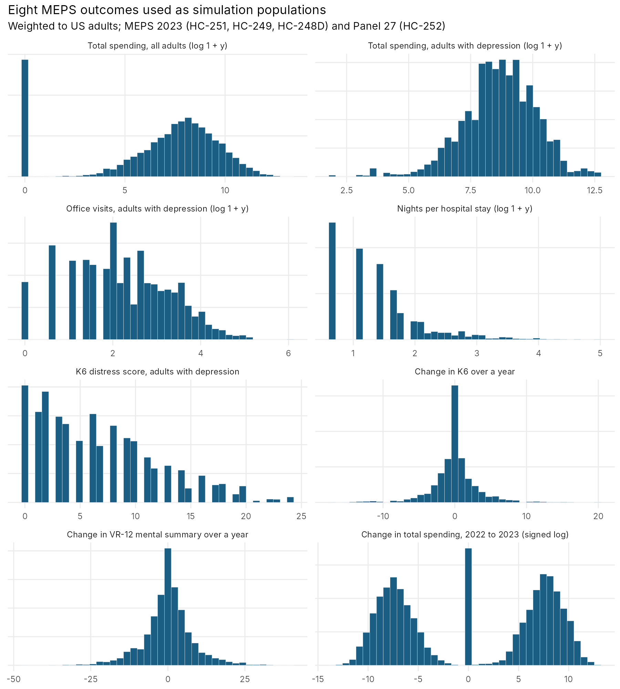
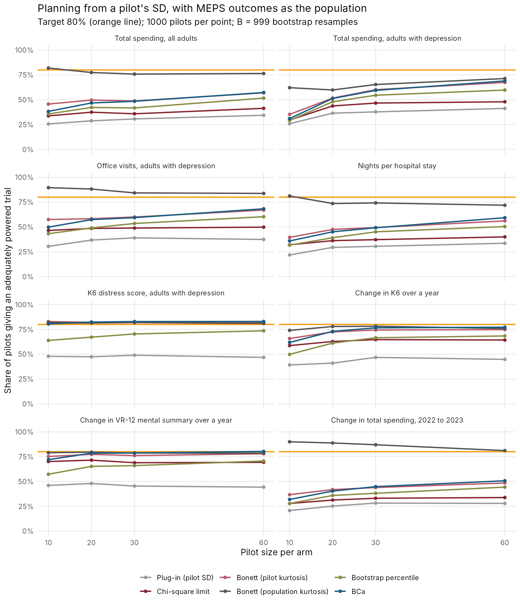

# Using MEPS data for simulations: a walkthrough

Eliot R. Weinstein · November 2026

This is a guide to **how** to use public data from the Medical Expenditure
Panel Survey (MEPS) as the population in a simulation study: how to find what
you need on the MEPS website, how to read the files into R and cut them down
to what you need, and how to draw simulated samples from them, with code
examples for several kinds of methods questions. It is written for students
and early-career researchers who need realistic data for a methods project, a
class, or a thesis (and for anyone who, like us, has not used MEPS in years).

The worked example uses four 2023 files, and the numbers quoted below are what
we got with them, shown so you know what to expect; you do not need those
files (or any data) to follow along. Section 4.2 shows how to adapt the code to
another year or other files, and `R/00_make_example_data.R` makes a
**synthetic** stand-in dataset with the same columns, so every script runs
before anything is downloaded (the scripts use it automatically when there is
no real data).

Contents

1. Why use real data as a simulation population?
2. A short tour of the MEPS website
3. What we downloaded for the example, and why
4. Turning the files into small, analysis-ready CSVs (and adapting to other years)
5. What the outcomes look like
6. Things to do with them (the example scripts)
7. Why this could be useful to others, and some cautions
8. References

---

## 1. Why use real data as a simulation population?

Simulation studies (Morris, White and Crowther 2019 give a good general guide)
usually generate data from textbook distributions: a normal, a gamma, a
lognormal with a skewness chosen to look "realistic". The trouble is that what
a method gets right or wrong often depends on exactly the features those
distributions smooth over: a lump at zero, a handful of enormous values, a
bounded scale with a floor, or a change score whose tails are much heavier than
the level it is computed from. Reviews of real data make the point bluntly.
Micceri (1989) examined 440 large distributions of achievement and
psychometric measures and found every one of them significantly non-normal;
Blanca et al. (2013) found only ~5.5% of 693 small samples of psychological
measures close to normal. Health care use and spending are further out still
(section 5).

A **plasmode** simulation (Franklin et al. 2014, writing about
pharmacoepidemiology in large health care databases) keeps the real data as
the population and draws simulated samples from it, adding a known "truth"
(e.g., a treatment effect of a chosen size) where one is needed. The method
being studied then meets the real shape of the data, not an idealized one,
while the truth is still known, so the simulation can still say whether the
method got the right answer.

We came to this from a project on planning a trial's sample size from a
pilot study. The usual rules take an upper confidence limit for the outcome's
standard deviation (SD) from the pilot and plug it into the sample-size
formula; earlier simulations with textbook distributions had shown these
rules fall short with skewed or heavy-tailed outcomes, and the natural
question was "how short, with real outcomes from health services research?"
MEPS answered that (section 6.1), and along the way it became clear that the
same four files support many other exercises.

**Why MEPS?** It is free; the files are public (no application or data use
committee); it is nationally representative of the US civilian
noninstitutionalized population (with survey weights to make it so); it covers
outcomes that health services researchers, biostatisticians and health
economists actually study (spending, visits, hospital stays, conditions, mental
health scores); it has a two-year panel, so the same people are measured twice;
and it is documented in great detail by the Agency for Healthcare Research and
Quality (AHRQ), which runs it.

---

## 2. A short tour of the MEPS website

### 2.1 The Data Files page

Everything starts at the **Data Files** page,
<https://meps.ahrq.gov/mepsweb/data_stats/download_data_files.jsp> (from the MEPS
home page: left-hand menu, **Data and Statistics → Data Files**). The page lets
you search the public use files (PUFs) by **data year**, by **type of data**
(e.g., "Household Full Year File"), by **file number** (e.g., HC-251), or by
words in the file's title. A search returns a list of matching files, each with
its number and title; clicking a title opens that file's own page (2.2).

It helps to know how the files are organized before searching (AHRQ's
"more info" page on data files describes each type):

- **Full Year Consolidated (FYC)** files: one row per person per calendar year,
  with demographics, insurance, health status, and annual totals of use and
  spending. This is the main file, and the one most analyses start from.
- **Event files**: one row per medical event (a prescription fill, a dental
  visit, a hospital stay, an emergency room visit, an outpatient visit, an
  office-based visit, home health), with that event's dates, details and
  payments. For a given year they share a number and differ by letter.
- **Medical Conditions** files: one row per condition a person reported, with
  ICD-10-CM codes (collapsed to three characters, and sometimes further, for
  confidentiality) and AHRQ's Clinical Classifications Software Refined (CCSR)
  categories.
- **Longitudinal** files: one row per person in a panel, followed for two
  years, with variables from both years' FYC files and a longitudinal weight.
- Others: jobs, person-round-plan (insurance plans), the condition-event and
  prescription-event link files, and pooled files for combining years
  (HC-036, with variance strata and PSUs consistent across years, and HC-036BRR,
  with replicate indicators for balanced repeated replication).

**File numbers.** Every PUF has a number, "HC-" followed by digits (and a
letter for event files); the files themselves are named with "h" instead of
"HC-" (HC-251 → `h251.dta`). For 2023 (from the file-name tables in AHRQ's
GitHub repository, 2.4):

| 2023 file | Number | File name |
|---|---|---|
| Full Year Consolidated | HC-251 | h251 |
| Medical Conditions | HC-249 | h249 |
| Prescribed medicines | HC-248A | h248a |
| Dental visits | HC-248B | h248b |
| Other medical expenses | HC-248C | h248c |
| **Hospital inpatient stays** | **HC-248D** | **h248d** |
| Emergency room visits | HC-248E | h248e |
| Outpatient visits | HC-248F | h248f |
| Office-based visits | HC-248G | h248g |
| Home health | HC-248H | h248h |
| Event link files (appendix) | HC-248I | h248if1, h248if2 |
| Jobs | HC-246 | h246 |
| Person-round-plan | HC-250 | h250 |
| **Panel 27 Longitudinal (2022–2023)** | **HC-252** | **h252** |

Most panels are followed for two years, but Panels 23 and 24 were extended to
four because of the COVID-19 pandemic, so they also have three- and four-year
longitudinal files; the four-year files are **HC-236** (Panel 23, 2018–2021)
and **HC-245** (Panel 24, 2019–2022).

### 2.2 A file's page

Each file's page has the same layout. Taking HC-251 as the example
(<https://meps.ahrq.gov/mepsweb/data_stats/download_data_files_detail.jsp?cboPufNumber=HC-251>):

- **Data files**, in several formats, each a zip: ASCII (with programming
  statements to read it), SAS V9, SAS transport, **Stata** (`h251dta.zip`) and
  Excel. AHRQ's own advice for R users is to take the Stata version: it loads
  fastest, with `haven::read_dta()`. (The SAS transport files for 2017 and later
  use a format R cannot read; avoid them.) The page suggests right-clicking a
  link and choosing "Save Link As".
- **Documentation**, as HTML and PDF (for HC-251,
  <https://meps.ahrq.gov/data_stats/download_data/pufs/h251/h251doc.shtml>).
- **Codebook**, as PDF and as a searchable HTML version: every variable, its
  label, and weighted and unweighted frequencies of its values.
- **Programming statements** for SAS, SPSS, Stata and R (needed only for the
  ASCII version).

### 2.3 Reading the documentation (what to look at first)

The documentation for every file follows one outline: **A. Data Use
Agreement**; **B. Background** (the household component, the medical provider
component, survey management and data collection); **C. Technical and
Programming Information** (general information, the data file, survey sample
information); **D. Variable-Source Crosswalk** (which questionnaire item each
variable came from); and appendices (for HC-251, the summary of use and
spending variables by type of care is especially useful). Four things are worth
reading before writing any code:

1. **The data use agreement (section A).** Use the data only for statistical
   reporting and analysis; make no attempt to identify anyone; do not link the
   data to other identifiable records (other than the National Health
   Interview Survey, under AHRQ's own arrangements); and cite AHRQ and MEPS as
   the data source. This is why our repository includes code but not data.
2. **Variable naming (section C.2).** Annual variables end in the two-digit
   year (`TOTEXP23`, total spending in 2023; `PERWT23F`, the final person
   weight). Variables asked in a particular interview "round" end in two round
   numbers, because two panels overlap in any year: `31` means round 3 for the
   older panel and round 1 for the newer one, `42` rounds 4 and 2, `53` rounds 5
   and 3. The mental health scales we use come from a self-administered
   questionnaire given in rounds 2 and 4, so in the FYC file they are
   `K6SUM42` (the Kessler 6 distress score, 0–24), `PHQ242` (the two-item
   Patient Health Questionnaire, 0–6) and `VMCS42` (the VR-12 mental component
   summary). The longitudinal file follows one panel, so the same scales there
   are `K6SUM2` (round 2, in 2022) and `K6SUM4` (round 4, in 2023), and annual
   totals are `TOTEXPY1` and `TOTEXPY2`.
3. **Missing-value codes.** MEPS codes missing values as negative numbers
   (e.g., −1 "inapplicable", −7 "refused", −8 "don't know", −15 "cannot be
   computed"), so a variable that "cannot" be negative may contain negative
   values. Forgetting this is the easiest way to get nonsense means. In 2023,
   for example, 5,413 of the 14,768 adults with a positive weight have a
   negative `K6SUM42` (4,992 coded −1 and 421 coded −15).
4. **Weights and variance estimation (sections C.3.1.3 and C.3.8).** MEPS is a
   complex sample: households are clustered in primary sampling units (PSUs,
   `VARPSU`) within strata (`VARSTR`), and some groups are oversampled, so each
   person has a weight. National estimates need the weights, and standard
   errors need the strata and PSUs (Taylor-series linearization, or balanced
   repeated replication with HC-036BRR). Section 6.3 shows both in R.

### 2.4 Other help AHRQ provides

- **AHRQ's GitHub repository**, <https://github.com/HHS-AHRQ/MEPS>: example code
  in R, SAS and Stata, workshop exercises, and quick-reference guides,
  including the tables of file names by year used above and the ICD-10 and
  CCSR labels used in the conditions files.
- **The `MEPS` R package** (<https://github.com/e-mitchell/meps_r_pkg>):
  `get_puf_names()` lists file names by year and type, `dl_meps()` downloads a
  file, and `read_MEPS()` reads one straight from the website.
- **The MEPS-HC Variable Explorer** (<https://datatools.ahrq.gov/meps-hc>),
  for finding a variable across years (names change: before 2002 the PSU
  variable carried a year suffix, and since 2018 the panel number is the first
  part of the person ID, `DUPERSID`).
- AHRQ's **precision guidelines** for MEPS estimates, and **workshops** run
  several times a year.

---

## 3. What we downloaded for the example, and why

| File | Why we wanted it |
|---|---|
| HC-251, 2023 Full Year Consolidated (18,919 people; 18,463 with a positive weight) | Annual spending (`TOTEXP23`), office visits (`OBTOTV23`), emergency visits, hospital discharges and nights, prescriptions, the mental health scales, weights and design variables, age and sex. |
| HC-249, 2023 Medical Conditions | To flag people with depression (ICD-10 F32 or F33), whose spending and visits are the population a depression or mental health services trial would recruit from. |
| HC-248D, 2023 Hospital Inpatient Stays (1,830 stays) | Nights per stay (`NUMNIGHX`), the population-level analogue of length of stay, one of the most common skewed outcomes in health services research. |
| HC-252, Panel 27 Longitudinal, 2022–2023 (8,292 people) | The same people in two years: baseline and follow-up spending and mental health scores, for change scores and baseline-adjusted (ANCOVA) analyses. |
| HC-245, Panel 24 Longitudinal, 2019–2022 (5,565 people), and HC-236, Panel 23 Longitudinal, 2018–2021 (7,080 people) | The same people in four years: spending each year, and the K6 and VR-12 in rounds 2, 4, 6 and 8, with the gaps real people leave (e.g., in Panel 24, only 1,733 of the 2,616 adults with a questionnaire weight have all four K6 scores). For trials with several follow-ups and incomplete data. |

We took the Stata versions and read them with `haven::read_dta()`.

---

## 4. Turning the files into small, analysis-ready CSVs

### 4.1 The extraction script

`R/01_extract_meps.R` reads the four `.dta` files and writes small CSVs to
`data/` (for 2023, about 2.6 MB in all, much smaller than the original files):

- `meps_fyc.csv`: one row per person, with the columns listed in section 3
  and the depression flags;
- `meps_stays.csv`: one row per hospital stay, with nights, payments, the
  person's age and the depression flags;
- `meps_panel.csv`: one row per panel member, with both years' spending, use
  and mental health scores, and the longitudinal weight;
- `meps_panel4_h245.csv` and `meps_panel4_h236.csv` (if `multi_year_panels` is
  set): the same for the four-year panels, with spending for years 1–4
  (`TOTEXPY1`–`TOTEXPY4`), the K6 and VR-12 for rounds 2, 4, 6 and 8, and two
  weights: `LONGWT` for the whole panel and `LSAQWT` for analyses of the
  self-administered questionnaire (the mental health scales);
- `meps_variables.csv`: the name and label of every variable in all four files
  (4,101 variables for 2023), so names can be checked without opening the
  codebooks;
- `meps_info.txt`: the data year and file names used.

A few decisions are worth explaining:

- **Columns are chosen by name pattern** (e.g., every column starting with
  `K6SUM`), so the script still works if a suffix is different from what we
  expected, and `meps_variables.csv` shows what was available.
- **Year suffixes are removed** in the output (`TOTEXP23` becomes `TOTEXP`,
  `PERWT23F` becomes `PERWT`, `AGE23X` becomes `AGE`), so the example scripts
  do not depend on the year.
- **Missing-value codes are kept** in the CSVs (as negative numbers) and dropped
  only at analysis time, so the choice is visible in the analysis code.
- **Depression** is defined two ways. The first (`depression`) is any
  condition coded ICD-10 F32 or F33 (in 2023: 1,436 adults with a positive
  weight). It is worth noting that AHRQ's ICD-10 label table lists F32
  ("depressive episode") but not F33, so recurrent depression may be collapsed
  into F32 in the public files; the codebook's frequencies for `ICD10CDX` show
  which codes actually appear. The second (`depression_ccsr`, added after our
  own run) uses AHRQ's CCSR category MBD002, "Depressive disorders".
- **All ages are kept** in the person file, so the adult restriction (18+) is
  made in the analysis, where it can be changed.
- **Paths on Windows.** A path copied from File Explorer uses backslashes
  (`C:\Users\...`), and R reads a single backslash in a string as the start of
  an escape sequence (`\U` is an error). Use forward slashes
  (`"C:/Users/you/MEPS 2023"`) or double backslashes. (This one cost us a
  rerun.)

### 4.2 Adapting the code to another year or other files

Only the settings at the top of `R/01_extract_meps.R` change:

```r
year  <- 2023
files <- c(fyc = "h251", cond = "h249", stays = "h248d", panel = "h252")
```

1. **Find the file names for your year.** Search the Data Files page by year
   (section 2.1), look them up in AHRQ's table of file names
   (`Quick_Reference_Guides/meps_file_names.csv` in AHRQ's GitHub repository),
   or ask R: `MEPS::get_puf_names(year = 2022)` lists every file for 2022 (e.g.,
   FYC `h243`, conditions `h241`, inpatient stays `h239d`). Longitudinal files
   are numbered by panel (`meps_longitudinal_file_names.csv`; Panel 26,
   2021–2022, is in that table too).
2. **Check the variable names.** Annual variables change their suffix with the
   year (handled by `yy`), but some variables are added, dropped or renamed
   between years (the VR-12 replaced the SF-12 in 2017, for example). Run the
   script once and look at `meps_variables.csv`, or use the MEPS-HC Variable
   Explorer (section 2.4).
3. **For other outcomes**, add patterns to the `keep()` call for the person
   file (e.g., `paste0("^(DVTOT|TOTSLF)", yy, "$")` for dental visits and
   out-of-pocket spending; they come out as `DVTOT` and `TOTSLF`), and add an
   entry to the list of populations in `R/00_functions.R`.
4. **For other event types**, swap `h248d` for another letter (section 2.1's
   table) and change the columns kept in step 3 of the script.
5. **Pooling years** gives larger populations: extract each year, stack the
   CSVs, and divide the weights by the number of years (AHRQ's HC-036 file has
   variance strata and PSUs that are consistent across years, if you also want
   design-based standard errors).

### 4.3 Trying the code without any data

`R/00_make_example_data.R` writes synthetic files with the same columns to
`data_example/`: spending with zeros and a long tail, overdispersed visit
counts, bounded mental health scores, correlated baseline and follow-up
values, and weights and design variables. They are made up (no result from
them says anything about real people), but they let every script run, so the
code can be learned before anything is downloaded. The scripts use them
automatically whenever `data/meps_fyc.csv` does not exist, and say so.

### 4.4 Defining the simulation populations

`R/00_functions.R` then defines eight "populations" from the CSVs: an outcome
vector and its survey weights, for adults (18+) with a positive weight and a
valid (non-negative) value; for a change between years, both years must be
valid. Simulated samples are drawn with replacement, **with probability
proportional to the weight**, so each draw behaves like a person sampled at
random from US adults as MEPS represents them.

---

## 5. What the outcomes look like

From `R/02_describe_populations.R` (weighted to US adults; kurtosis is 3 for a
normal distribution):



| Population | N | Mean | SD | Skewness | Kurtosis | % zero | 99th percentile |
|---|---|---|---|---|---|---|---|
| Total spending, all adults | 14,768 | $8,579 | $21,449 | 7.5 | 99 | 14% | $98,554 |
| Total spending, adults with depression | 1,436 | $14,873 | $28,863 | 5.6 | 43 | 0% | $159,241 |
| Office visits, adults with depression | 1,436 | 16.0 | 21.0 | 4.0 | 39 | 4% | 104 |
| Nights per hospital stay (adults) | 1,611 stays | 4.9 | 7.9 | 7.0 | 82 | 0% | 36 |
| K6 score, adults with depression | 982 | 6.8 | 5.4 | 0.8 | 3.0 | 10% | 21 |
| Change in K6, 2022 to 2023 | 3,077 | 0.0 | 3.2 | 0.1 | 8.3 | 33% | 9 |
| Change in VR-12 mental summary | 3,303 | 0.1 | 7.9 | −0.1 | 5.4 | 5% | 22 |
| Change in total spending | 6,513 | $824 | $23,321 | −3.5 | 187 | 9% | $67,545 |

Two things stand out. First, the spending and use outcomes are far outside the
range in Blanca et al.'s review of psychological measures (whose largest
kurtosis was ~10.4 on this scale): the kurtosis of spending is ~99, of nights
per stay ~82, and of the change in spending ~187. Second, the K6 score among
adults with depression has almost exactly the kurtosis of a normal
distribution, but the **change** in K6 over a year (the quantity a trial with a
baseline would be sized on) has a kurtosis of ~8.3, with a third of people
not changing at all. This echoes Micceri's finding that gain scores were among
the most non-normal measures he examined.

---

## 6. Things to do with them

### 6.1 Planning a trial from a pilot's SD (`R/03_plasmode_sd_planning.R`)

*The question.* A two-arm trial's size depends on the outcome's SD. Planning
from a small pilot's SD (the "plug-in" approach) gives an underpowered trial
about half the time or more, so the usual recommendation (Browne 1995) is to
plan from an upper confidence limit for the SD at, say, 80%, so that the main
trial has its intended power with probability ~80%. The standard limit uses
the chi-square distribution and assumes a normal outcome. Bonett (2006)
adjusts the limit for the kurtosis; bootstrap limits (percentile, BCa) assume
nothing about the shape.

*The simulation.* Each population plays the truth: two arms of m people
(m = 10, 20, 30, 60) are drawn from it, each rule gives an upper limit for the
pooled SD, and the plan is "adequate" if the limit is at least the population
SD. A rule that works should give adequate plans in ~80% of pilots. We also
ran Bonett's limit with the population's kurtosis (an "oracle": what knowing
the tails from outside the pilot would buy). 1,000 pilots per point.

*What we found* (share of pilots giving an adequate plan, m = 10 to 60):



| Population | Plug-in | Chi-square | Bonett | Percentile | BCa | Bonett, true kurtosis |
|---|---|---|---|---|---|---|
| Spending, all adults | 26–34% | 34–41% | 46–57% | 36–52% | 38–57% | 76–82% |
| Spending, depression | 26–41% | 29–48% | 35–67% | 29–60% | 31–69% | 60–71% |
| Office visits, depression | 30–39% | 47–50% | 57–67% | 43–60% | 50–68% | 84–90% |
| Nights per stay | 22–34% | 32–40% | 40–56% | 32–50% | 36–59% | 72–81% |
| K6, depression | 47–49% | 81–82% | 82–83% | 64–74% | 81–83% | 81–82% |
| Change in K6 | 39–47% | 59–65% | 66–75% | 50–68% | 62–77% | 74–78% |
| Change in VR-12 mental | 44–48% | 69–72% | 75–78% | 57–71% | 72–80% | 79–80% |
| Change in spending | 21–28% | 28–34% | 37–48% | 28–44% | 32–51% | 81–90% |

For a near-normal score (K6 among adults with depression), the chi-square limit
does what it promises (81–82%). For change scores it falls to 59–72%, and for
spending, visits and hospital nights every rule that uses only the pilot gives
an adequately powered trial in at most ~two thirds of cases, and often in a
third. The oracle column shows that the missing ingredient is information
about the tails, which a pilot of 10–60 per arm mostly cannot provide. (This
is the companion project's "problem 3", now with real data; a practical
implication is to borrow the kurtosis from a larger dataset, such as MEPS
itself, when planning a trial with a cost or utilization outcome.)

### 6.2 How standard tests behave with costs (`R/04_tests_for_costs.R`)

*The question.* With cost data, should a trial compare means with a t test, or
use a rank test or a test on log costs? Thompson and Barber (2000) argued that
the arithmetic mean is what budget holders need, so the analysis should be
about the mean, but rank and log tests often look more powerful.

*The simulation.* Two arms of n (25 to 2,000) drawn from MEPS spending; under
the null both arms come from the same population, and under the alternative
the treatment arm's spending is 20% lower for everyone. 2,000 trials per
point.

*What we found.*

- **Type I error.** The Wilcoxon and log-scale tests are close to 5% at every
  n. Welch's t test is conservative up to n = 100 per arm (2.6–4.2%; 2.6% at
  n = 25 for all adults and 2.9% in the depression group), a known effect of
  strong skewness, and close to 5% from n = 250 on.
- **Power for a 20% cut in spending**, all adults: at n = 2,000 per arm, 81%
  for Welch's t, 83% for Wilcoxon and only 49% for the t test on log(1 + y)
  (the 14% of adults with no spending stay at zero, which dilutes the effect
  on the log scale). Among adults with depression (almost none with zero
  spending), the rank and log tests are more powerful than the t test (e.g.,
  at n = 500: 70% and 67% against 45%).
- **The usual formula works for the t test at these sizes.** The
  normal-approximation power for the mean difference (with the population SD)
  was within ~2 points of the simulated power from n = 100 on (e.g., 80% vs
  81% at n = 2,000, all adults).

The more powerful tests answer different questions (a shift in the
distribution, or a ratio of geometric-type means), so "more power" here is not
a reason to switch; it is a reason to be clear about the estimand.

### 6.3 Survey-design inference, and a bootstrap that respects the design (`R/05_survey_design_and_concentration.R`)

*The question.* How much do MEPS's weights, strata and clusters change a
standard error, and does a bootstrap agree with the textbook (Taylor-series)
answer?

*What we found* (adults, 2023; the survey design is declared on everyone and
then restricted to adults, a "domain" analysis, which is the correct order):

- Mean spending $8,579, with a Taylor-series SE of $202 and a design effect of
  ~1.3; a naive analysis (unweighted, as if a simple random sample) reports an
  SE of $192 and, more importantly, a different mean ($9,764), since it
  ignores the weights.
- A with-replacement bootstrap of PSUs within strata, with rescaled weights
  (Rao and Wu 1988; `survey`'s "subbootstrap", 500 replicates), gives an SE of
  $195, close to the Taylor-series value.
- Adults with depression spent ~$14,873 on average, against ~$7,924 for
  adults without.

*Concentration of spending* (an economics-style summary; bootstrap SEs in
parentheses): the top 1% of adults account for 18.9% (0.7) of all adult
spending, the top 5% for 46.4% (0.8), the top 10% for 62.9% (0.7), and the top
half for 96.7% (0.1); the Gini coefficient is 0.77 (0.004). Figures like these
are standard calibration targets in health economics models, and the code
shows how to get them, with uncertainty, from MEPS.

### 6.4 Calibrating a parametric model, and what it misses (`R/06_parametric_vs_plasmode.R`)

*The question.* The alternative to a plasmode simulation is to fit a model to
the real data and simulate from the fit. For spending, the standard models are
two-part models (Duan et al. 1983): a logit for any spending, then either a
gamma GLM with a log link or a linear model for log spending among spenders
(Manning and Mullahy 2001 discuss the choice); for counts, the negative
binomial. Do the calibrated models reproduce the real tails?

*What we found* (covariates: age group, sex, depression; one synthetic value
per real adult):

| Series | Mean | SD | Kurtosis | 99th percentile | Top 1% share |
|---|---|---|---|---|---|
| Real spending | $8,579 | $21,449 | 99 | $98,554 | 18.8% |
| Two-part, gamma | $8,355 | $24,107 | 80 | $115,375 | 21.2% |
| Two-part, lognormal | $10,993 | $59,784 | 1,642 | $142,325 | 34.1% |
| Real office visits | 7.3 | 13.3 | 51 | 63 | 12.6% |
| Negative binomial | 7.5 | 14.4 | 81 | 65 | 13.4% |

The gamma two-part model and the negative binomial come reasonably close; the
lognormal two-part model, a common default, produces a tail far heavier than
the real one, and its mean is ~28% too high. Rerunning the pilot-SD check of
6.1 in each synthetic world (m = 20 and 60) shows why this matters: in the
gamma world the chi-square and percentile rules give 36–54% adequate plans,
close to the real data's 33–51%, but in the lognormal world they give 12–23%.
A simulation calibrated with the "wrong" (but standard) family would have
reached a much more pessimistic conclusion than the real data support. The
plasmode approach sidesteps the choice of family entirely.

### 6.5 Using a baseline measurement: change score, ANCOVA, and the alternatives (`R/07` to `R/11`)

*The question.* A trial with a baseline measurement can analyse the follow-up
alone, the change from baseline, or the follow-up adjusted for baseline
(ANCOVA). With correlation ρ between baseline and follow-up, the change score
beats the follow-up alone only when ρ > 0.5, and ANCOVA is never worse than
either (Frison and Pocock 1992; Vickers and Altman 2001); in a randomized trial
with complete data, ANCOVA is (asymptotically) as efficient as any analysis
that uses the baseline linearly (Yang and Tsiatis 2001). The alternatives earn
their place in situations that are common in practice: treatment effects that
vary from person to person, follow-ups that are missing, and several
follow-ups rather than one. Scripts 07 to 09 compare these analyses (script 10
tests two remedies for what they find, and script 11 turns to dropout that
depends on the missing values themselves):

| Method | What it is | When it should help |
|---|---|---|
| Follow-up only; change score | Difference in mean follow-up, or in mean change | Rarely; included as the usual baselines |
| ANCOVA | Follow-up regressed on arm and baseline | The standard; efficient with complete data |
| ANCOVA with interaction (Lin 2013) | Adds arm × (centred) baseline, robust (HC2) SE; the effect is averaged over everyone's baseline | Effects that vary with baseline; never less efficient than follow-up only |
| cLDA / MMRM (Liang and Zeger 2000; Lu 2010; Mallinckrodt et al. 2008; fitted by likelihood as in Laird, Lange and Stram 1987) | Baseline and follow-ups all treated as outcomes, with a common baseline mean and an unstructured covariance; likelihood-based | Missing follow-ups (valid under missing at random, MAR), missing baselines, several follow-ups |
| Random-slope mixed model (Hedeker and Gibbons 2006) | Random intercept and slope per person; effect = arm × time | Several follow-ups, when the effect grows roughly linearly |
| GEE (Liang and Zeger 1986) | Same mean model, exchangeable working correlation, robust SE | Several follow-ups; valid only when missingness is unrelated to the outcomes (MCAR) |
| AIPW (Tsiatis et al. 2008) | Doubly robust: a model for the outcome and a model for dropout, each in baseline and arm; SE from the influence function (Hines et al. 2022) | Varying effects and MAR dropout together; non-linear baseline relationships |

#### 6.5.1 One follow-up, complete data, constant effect (`R/07_baseline_adjustment_methods.R`)

Panel 27 adults (2022 to 2023); a difference of 0.3 follow-up SDs; trials at
the size ANCOVA needs (2,000 with the difference and 2,000 without):

| Outcome | ρ | n per arm: follow-up / change / ANCOVA | Power at the ANCOVA size: follow-up / change / ANCOVA / cLDA / Lin / AIPW |
|---|---|---|---|
| K6 | 0.66 | 175 / 116 / 99 | 56% / 75% / 81% / 81% / 81% / 81% |
| VR-12 mental summary | 0.60 | 175 / 135 / 112 | 61% / 74% / 80% / 81% / 80% / 81% |
| Total spending | 0.44 | 175 / 196 / 142 | 76% / 73% / 84% / 84% / 82% / 82% |

Every method was unbiased and had 93–96% coverage of nominal 95% intervals,
and type I error between 4.4% and 6.6%. For the mental health scores ρ is above
0.5 and the change score helps; for spending it is below 0.5 and the change
score is *worse* than ignoring the baseline, exactly as the theory says. cLDA
gave exactly the ANCOVA estimate (with complete data the two coincide), and the
interaction model and AIPW were as good as ANCOVA for the scores and slightly
less efficient for spending, where AIPW's influence-function SE was also too
small (by 13–28%). In short: with one follow-up and complete data, nothing
beats ANCOVA, and the others cost little.

#### 6.5.2 Effects that vary, and follow-ups that are missing (`R/08_varying_effects_and_dropout.R`)

The same panel, with two complications: an effect that varies with baseline
(from half to one and a half times the average, larger for higher baseline
values), and ~25% of follow-ups missing at random given baseline and arm (people
with high baseline values drop out more, especially in the treatment arm).
1,000 trials per setting; relative bias for the average treatment effect,
coverage of 95% intervals, and power:

| Setting | Method | K6 | VR-12 mental | Spending |
|---|---|---|---|---|
| Varying effect, complete data | ANCOVA | +2%, 95%, 80% | +1%, 96%, 82% | −3%, 96%, 82% |
| | Lin / AIPW | +3% / +2%; 95% / 94% | +1% / +1%; 96% / 95% | −2% / −3%; 95% / 94% |
| Constant effect, dropout | Follow-up only (complete cases) | −42%, 87% | −31%, 90% | −27%, 91% |
| | Change score (complete cases) | +20%, 91% | +20%, 93% | +11%, 95% |
| | ANCOVA (complete cases) = cLDA | 0%, 94%, 74% | +1%, 95%, 65% | −6%, 96%, 80% |
| | Lin | 0%, 92%, 53% | +1%, 94%, 71% | +1%, 91%, 65% |
| | AIPW | −2%, 88%, 57% | +1%, 93%, 72% | −1%, 85%, 67% |
| Varying effect, dropout | ANCOVA (complete cases) = cLDA | −7%, 95%, 67% | −6%, 94%, 60% | −13%, 93%, 77% |
| | Lin | +1%, 93%, 54% | −1%, 95%, 69% | +2%, 90%, 63% |
| | AIPW | −2%, 88%, 57% | +1%, 93%, 71% | −2%, 85%, 66% |

What this shows:

- **With complete data, a varying effect does no harm**: in a 1:1 randomized
  trial ANCOVA still estimates the average effect, and its usual SE was fine.
- **Dropout that depends on baseline breaks the simple comparisons**: the
  complete-case follow-up and change-score analyses were badly biased (−42% to
  +20%), because the people who remain differ in baseline between the arms.
  ANCOVA on complete cases stayed unbiased for the scores, because it compares
  people with the same baseline, and the dropout depended only on baseline.
- **Dropout plus a varying effect biases ANCOVA too** (−6% to −13%): ANCOVA's
  single slope averages the effect over the baselines of the people who
  *remain*, who are not the people randomized. The interaction model (with the
  effect averaged over everyone's baseline) and AIPW removed the bias.
- **cLDA gave exactly the complete-case ANCOVA estimate here.** With a complete
  baseline and a single follow-up, the likelihood reduces to that regression,
  so cLDA's advantage appears only with missing baselines or several follow-ups
  (section 6.5.3), and it shares ANCOVA's single-slope assumption.
- **Removing the bias costs precision, and AIPW's SE was too small.** With steep
  differential dropout, the interaction model and AIPW lean on the few
  high-baseline people left in the treatment arm; their SEs were about the same
  as ANCOVA's for the VR-12, 30–40% larger for the K6, and 70–100% larger for
  spending, and AIPW's simple influence-function SE understated its
  variability (coverage 85–93%). A bootstrap SE (resampling people, refitting
  both models) would be the safer choice with samples of this size.

#### 6.5.3 Several follow-ups, with real missing data (`R/09_several_follow_ups.R`)

Panels 23 and 24 were followed for four years, so each person has up to four
annual values of spending and four questionnaire values of the K6 and VR-12
mental summary, with the gaps real people leave (intermittent as well as
monotone). The script pools both panels and draws trials of people with an
observed baseline, keeping each person's own pattern of missing values, with
an effect that grows linearly to 0.3 SDs at the last follow-up. Scenario A has
a constant effect and only MEPS's own missingness; scenario B adds an effect
that varies with baseline and extra dropout that depends on baseline and arm.
It compares ANCOVA on the last follow-up (complete cases), ANCOVA on the mean
of each person's follow-ups (a summary measure), MMRM (the cLDA form, with an
unstructured covariance), a random-intercept, random-slope mixed model, GEE
with an exchangeable working correlation, and AIPW for the last follow-up.
500 trials per setting (pooled panels: 5,687 adults for the K6, 5,973 for the
VR-12, 9,740 for spending; 77–99% of them have every value):

| Scenario | Method | K6 | VR-12 mental | Spending |
|---|---|---|---|---|
| A: constant effect, MEPS's own missing values | ANCOVA, last follow-up | +1%, 95%, 80% | +4%, 95%, 83% | −2%, 95%, 91% |
| | MMRM | +1%, 94%, 80% | +4%, 95%, 83% | −2%, 95%, 91% |
| | Random-slope model | +1%, 95%, 80% | +4%, 95%, 84% | −1%, 97%, 87% |
| | GEE (exchangeable) | +1%, 95%, 81% | +4%, 95%, 83% | −2%, 95%, 91% |
| | AIPW, last follow-up | +1%, 94%, 79% | +5%, 95%, 84% | 0%, 94%, 90% |
| | Summary measure (mean of follow-ups) | +3%, 95%, 67% | +6%, 93%, 69% | −1%, 96%, 81% |
| B: varying effect + MAR dropout | ANCOVA, last follow-up | −5%, 96%, 68% | −5%, 96%, 60% | −15%, 91%, 86% |
| | MMRM | −4%, 95%, 71% | −4%, 95%, 65% | −12%, 92%, 86% |
| | Random-slope model | −4%, 94%, 74% | −4%, 95%, 69% | −11%, 94%, 77% |
| | GEE (exchangeable) | −8%, 94%, 69% | −3%, 96%, 66% | −15%, 91%, 84% |
| | AIPW, last follow-up | +3%, 87%, 62% | +1%, 95%, 69% | −4%, 89%, 79% |
| | Summary measure | −7%, 94%, 55% | −7%, 96%, 53% | −13%, 94%, 71% |

(Each cell: relative bias for the target, coverage of 95% intervals, power.)

What this shows:

- **With MEPS's own missing values (scenario A), every method worked**, and
  MMRM, GEE and ANCOVA on the last follow-up gave nearly identical answers. That
  is because most of the gaps in these panels are in the middle years and are
  unrelated to arm (only 1–2.5% of people with a baseline miss the last value),
  so there was little for the longitudinal models to recover. (The +4% for
  the VR-12, shared by every method, is about 2.5 Monte Carlo SEs from zero.)
- **The summary measure answers a different question** (the average effect
  over the follow-ups, which is smaller when the effect builds over time) and
  had less power for it (53–81%).
- **When the effect varies and dropout depends on baseline and arm (scenario
  B), the likelihood-based models did not remove the bias.** MMRM and the
  random-slope model are valid under MAR only if their model is right, and both
  assume one covariance matrix (so one baseline-to-follow-up relationship) for
  both arms; with an effect that varies by baseline, that is wrong. They were a
  little less biased than complete-case ANCOVA for the scores (−4% against −5%)
  and for spending (−11% to −12% against −15%). AIPW, which models dropout
  directly and lets the outcome model differ by arm, was close to unbiased
  (−4% to +3%), but again its simple SE was too small (coverage 87–95%), and
  for spending the SE understated the variability by about 30–45%.
- **In practice**, these results point to fitting the longitudinal model with
  arm-specific covariance matrices or an arm-by-baseline interaction when
  effects may vary, and to a bootstrap SE for AIPW (both tested in section
  6.5.4).

#### 6.5.4 Two remedies: MMRM fitted by arm, and a bootstrap SE for AIPW (`R/10_remedies.R`)

Sections 6.5.2 and 6.5.3 left two suggestions untested. The first is to let the
baseline-to-follow-up relationship differ by arm. We fit the MMRM separately in
each arm, conditional on baseline: the follow-ups on time (as a factor), with a
separate baseline slope at each time, an unstructured correlation and a
separate variance at each time. Each arm then has its own covariance and its
own baseline slopes, and the effect at the last follow-up is the difference
between the two arms' predicted means, averaged over the baselines of everyone
randomized (with a centred baseline, the difference of the two time-4
intercepts). A second version uses a natural spline in baseline (3 df) at each
time. With one follow-up and a complete baseline this is the same estimate as
Lin's interaction ANCOVA, so in the one-follow-up setting Lin stands in for it.
The second suggestion is a nonparametric bootstrap SE for AIPW (resampling
people within arm and refitting both the outcome and the dropout model, B =
200), with the percentile interval as a check. We also ran AIPW with linear
(not spline) outcome and dropout models, to see whether the splines were
behind the too-small SEs. 500 trials per setting, the same populations, sizes
and dropout as in 6.5.2 and 6.5.3 (new random draws, so the reference methods
differ a little from the tables above; the Monte Carlo SE of each relative bias
is ~1.5–2%).

*One follow-up* (the section 6.5.2 setting; relative bias, coverage of 95%
intervals, power):

| Scenario | Method | K6 | VR-12 mental | Spending |
|---|---|---|---|---|
| Constant effect, dropout | ANCOVA (complete cases) | −3%, 96%, 74% | 0%, 95%, 64% | −5%, 95%, 86% |
| | Lin (= MMRM by arm) | −3%, 94%, 53% | 0%, 94%, 67% | +1%, 90%, 67% |
| | AIPW, influence-function SE | −3%, 89%, 58% | +2%, 94%, 69% | −2%, 86%, 71% |
| | AIPW, bootstrap SE | −3%, 96%, 42% | +2%, 96%, 65% | −2%, 97%, 45% |
| | AIPW, bootstrap percentile interval | −3%, 95%, 47% | +2%, 96%, 67% | −2%, 93%, 55% |
| | AIPW, linear models | −7%, 94%, 41% | 0%, 95%, 67% | −14%, 91%, 43% |
| Varying effect, dropout | ANCOVA (complete cases) | −9%, 94%, 68% | −7%, 94%, 61% | −14%, 94%, 74% |
| | Lin (= MMRM by arm) | +1%, 95%, 58% | −2%, 96%, 70% | −2%, 90%, 56% |
| | AIPW, influence-function SE | +2%, 90%, 63% | −1%, 95%, 69% | −7%, 84%, 62% |
| | AIPW, bootstrap SE | +2%, 96%, 47% | −1%, 95%, 66% | −7%, 97%, 38% |
| | AIPW, bootstrap percentile interval | +2%, 94%, 50% | −1%, 94%, 67% | −7%, 96%, 47% |
| | AIPW, linear models | −14%, 96%, 45% | −2%, 96%, 68% | −32%, 91%, 32% |

*Three follow-ups* (the section 6.5.3 setting; the effect at the last
follow-up):

| Scenario | Method | K6 | VR-12 mental | Spending |
|---|---|---|---|---|
| A: constant effect, MEPS's own missing values | MMRM (one covariance) | −2%, 95%, 83% | +3%, 96%, 83% | −2%, 94%, 89% |
| | MMRM by arm | −2%, 95%, 83% | +3%, 95%, 83% | −2%, 93%, 89% |
| | MMRM by arm, spline in baseline | −2%, 95%, 81% | +3%, 96%, 84% | 0%, 90%, 87% |
| | AIPW, influence-function SE | −2%, 95%, 81% | +2%, 95%, 84% | −3%, 93%, 90% |
| | AIPW, bootstrap SE | −2%, 95%, 79% | +2%, 97%, 80% | −3%, 95%, 86% |
| B: varying effect + MAR dropout | MMRM (one covariance) | −5%, 94%, 73% | −7%, 95%, 64% | −12%, 93%, 85% |
| | MMRM by arm | +2%, 89%, 73% | −4%, 97%, 65% | −1%, 83%, 82% |
| | MMRM by arm, spline in baseline | 0%, 88%, 66% | −1%, 97%, 64% | −2%, 78%, 68% |
| | AIPW, influence-function SE | +2%, 90%, 63% | −2%, 95%, 68% | −3%, 85%, 76% |
| | AIPW, bootstrap SE | +2%, 96%, 48% | −2%, 95%, 65% | −3%, 95%, 58% |
| | AIPW, bootstrap percentile interval | +2%, 95%, 50% | −2%, 95%, 64% | −3%, 93%, 63% |

What this shows:

- **Fitting the MMRM by arm removes the bias.** In scenario B the one-covariance
  MMRM was biased by −5% to −12% (as in section 6.5.3); fitted by arm, the bias
  was −4% to +2% with a linear baseline term and −2% to 0% with the spline. With
  one follow-up, Lin's interaction ANCOVA (the same estimate) did the same
  (−2% to +1%, against −7% to −14% for complete-case ANCOVA). When nothing
  varies (scenario A), fitting by arm cost nothing: the estimates and SEs were
  almost the same as the usual MMRM's.
- **But the by-arm MMRM's model-based SE was too small when it mattered.** In
  scenario B it understated the variability by ~15% for the K6 and ~40% for
  spending (coverage 89% and 83%; for spending the empirical SD is itself
  inflated by a few extreme trials), and the spline version for spending was
  unstable (its empirical SD was 2.3 times the linear version's; a spline in
  raw spending is fitted to the few people with very high baselines who remain).
  The averaging over everyone's baseline adds a term the SE leaves out, but a
  rough calculation puts it well under 1% of the variance for the K6; most of the
  shortfall is the model's variance assumptions (a variance that changes with
  time but not with baseline, and normal tails), which the steep dropout makes
  matter. A robust (sandwich) or bootstrap SE for the by-arm MMRM is the obvious
  next step (not run here). Lin's HC2 SE, which is robust, was also a little
  small for spending (coverage 90%), which is what one would expect of a
  sandwich SE in arms of ~100 people with a heavy-tailed outcome.
- **The bootstrap SE fixes AIPW's coverage.** Across both parts, AIPW with the
  influence-function SE covered 84–95% of the time; with the bootstrap SE,
  95–97%, and the percentile interval 93–96%. For the scores and for spending
  with one follow-up, the mean bootstrap SE was within −4% to +8% of the
  empirical SD; for spending with three follow-ups it was 25–30% smaller, but
  that empirical SD is dominated by a few trials with extreme values, and
  coverage was still 95%.
- **The splines were only part of the cause of the small SEs.** AIPW with
  linear models still had SEs that were too small for the K6 and spending (by
  11–16%, against 19–33% with splines), and it was biased (−14% to −32% when
  the effect varied): with both models wrong (dropout here
  depends on the *rank* of the baseline, which is far from linear in spending)
  the double robustness does not help. The small SE seems to come from the large
  inverse-probability weights for the few high-baseline treated people who
  remain, which the influence function estimates poorly in arms of this size.
- **The price is precision, and it depends on the outcome.** Once the SEs are
  honest, the methods that remove the bias need much bigger trials than ANCOVA
  for the K6 and spending, and about the same for the VR-12. Comparing empirical
  SDs in the varying-effect settings, AIPW's variance was ~2.1–2.3 times
  ANCOVA's for the K6, ~3.5–3.7 times for spending and ~1.0–1.1 times for the
  VR-12 (for the by-arm MMRM, ~1.5 times for the K6 and ~2.4 times for spending
  with three follow-ups). It is worth noting that this is the price of
  protection against a varying effect *combined* with steep, arm-dependent
  dropout; when either is absent, ANCOVA or the usual MMRM is unbiased and much
  more precise.

#### 6.5.5 Dropout that depends on the missing values: a delta-adjusted sensitivity analysis and its tipping point (`R/11_mnar_sensitivity.R`)

Everything so far assumed that whether a value is missing depends only on what
was observed (MAR). If people leave because they are doing badly at the visit
they miss, dropout is *missing not at random* (MNAR), and the observed data
cannot tell the two apart. The usual advice (National Research Council 2010;
ICH E9(R1), 2019) is to keep an analysis valid under MAR as the primary one and
add a sensitivity analysis. The most common is the delta-adjusted
pattern-mixture model (Little 1994; Daniels and Hogan 2008; Ratitch, O'Kelly
and Tosiello 2013; Cro et al. 2020): impute the missing values under MAR, then
shift the imputed values by δ, the assumed difference in mean between the
people who dropped out and those with the same history who stayed, and find
the **tipping point**, the δ at which the conclusion changes (Yan, Lee and Li
2009). (Daniels et al. 2015 use the same idea for repeated-attempt designs, with
δ informed by how hard people were to reach.)

The setting is the three-follow-up one of section 6.5.3 with a constant effect
that grows to 0.3 SDs of the last value, restricted to adults who have all four
values (4,372 for the K6, 5,018 for the VR-12, 9,232 for spending), so that the
only missing values are the ones we create and the answer is known. Dropout is
monotone, about 25% in each arm by the last follow-up, and its hazard depends on
the normal score of a value, low values (against the direction of the effect)
leaving more often: in **MAR** on the previous, observed value; in **MNAR1** on
the current, missing value, the same way in both arms; in **MNAR2** on the
current value in the treated arm only (treated people who are not benefiting
leave, a "lack of efficacy" pattern), with control dropout completely at
random. Each trial has the size needed for 80% power with ANCOVA, inflated for
25% dropout (147, 164 and 220 per arm). The methods: ANCOVA before any dropout
(the reference); ANCOVA on complete cases; the MMRM of section 6.5.3; multiple
imputation under MAR (sequential regressions on the earlier values, by arm,
proper draws, M = 20, ANCOVA in each completed data set, Rubin's rules); the
same imputations shifted by each arm's *true* δ (computed from the population,
so not available in practice; it shows what the adjustment does when δ is
right); and reference-based "copy reference" imputation, in which treated
dropouts are imputed from the control arm's models given their own history
(Carpenter, Roger and Kenward 2013). 500 trials per setting.

| Scenario | Method | K6 | VR-12 mental | Spending |
|---|---|---|---|---|
| MAR | MMRM | 0%, 94%, 76% | 0%, 94%, 87% | −4%, 94%, 89% |
| | MI under MAR | −1%, 96%, 76% | 0%, 92%, 81% | −3%, 97%, 89% |
| | Copy reference | −22%, 96%, 55% | −21%, 93%, 72% | −26%, 93%, 75% |
| MNAR1: same in both arms | MMRM | −7%, 95%, 72% | +4%, 95%, 92% | −5%, 96%, 88% |
| | MI under MAR | −7%, 96%, 73% | +4%, 93%, 89% | −5%, 98%, 88% |
| | MI shifted by the true δ | −4%, 96%, 75% | +1%, 93%, 86% | +2%, 98%, 90% |
| MNAR2: treated non-responders leave | Complete-case ANCOVA | +16%, 93%, 90% | +57%, 60%, 100% | +10%, 95%, 94% |
| | MMRM | +12%, 93%, 89% | +47%, 71%, 100% | +8%, 95%, 93% |
| | MI under MAR | +12%, 94%, 88% | +52%, 65%, 100% | +7%, 94%, 93% |
| | MI shifted by the true δ | −4%, 94%, 76% | +1%, 94%, 85% | −3%, 96%, 89% |
| | Copy reference | −12%, 98%, 74% | +14%, 98%, 98% | −17%, 96%, 84% |

(Each cell: relative bias for the effect at the last follow-up as if no one had
left, coverage of 95% intervals, power. The Monte Carlo SE of each relative
bias is ~1.3–2%; the reference ANCOVA was within −4% to +1%.)

The true δ for the treated arm, and what the tipping-point analysis of the MAR
imputation found (δ in SDs of the last value; the control arm left unshifted):

| | K6 | VR-12 mental | Spending |
|---|---|---|---|
| True δ, treated arm: MAR, MNAR1, MNAR2 | −0.01, −0.15, −0.18 | −0.01, −0.42, −0.60 | −0.08, −0.10, −0.13 |
| Tipping point, median (MAR / MNAR1 / MNAR2) | −0.29 / −0.25 / −0.48 | −0.40 / −0.48 / −0.99 | −0.47 / −0.46 / −0.63 |
| Still significant if δ = −0.25 (MAR / MNAR1 / MNAR2) | 54% / 50% / 71% | 62% / 72% / 97% | 72% / 73% / 84% |
| Still significant if δ = −0.5 | 33% / 25% / 47% | 40% / 48% / 91% | 46% / 44% / 62% |

What this shows:

- **When dropout depends on the missing values the same way in both arms
  (MNAR1), the MAR analyses were nearly unbiased for the difference** (−7% to
  +4%; for the K6, about −3% beyond what the reference ANCOVA showed by chance in
  those trials), though each arm's mean was off: the δ of each arm was large
  (−0.18 and −0.15 SDs for the K6, −0.39 and −0.42 for the VR-12) but similar,
  so it cancelled. It is worth noting that this cancellation is an assumption
  too, and the δ-adjusted analysis with the same δ in both arms says nothing
  about it.
- **When only treated non-responders leave (MNAR2), every MAR analysis
  overstated the effect**: by 7–16% for spending and the K6, and by about half
  for the VR-12, with coverage 60–71%. The same dropout mechanism produced very
  different δs (−0.13 to −0.60 SDs) because it acts on ranks: the VR-12's long
  lower tail puts the people who leave far below their predictions, while for
  spending the low ranks are bunched near zero. A δ cannot be borrowed from one
  outcome for another.
- **With the right δ, the adjustment removed the bias** (−4% to +2% in every
  setting), and its intervals covered 92–98%. In practice δ is not known; the
  tipping point turns the question into "how much worse would treated dropouts
  have to be?", which clinicians can judge. Here the tipping point was beyond
  the true δ in 76–89% of the MNAR2 trials, about the same as the share that
  would have been significant under the correct analysis.
- **Copy-reference imputation is conservative by design.** It answers a
  different question (what if treated dropouts behaved like controls after
  leaving, close to a treatment-policy estimand when dropouts stop treatment),
  so against the "everyone followed" target here it was biased down by 12–27%
  (up by 14% for the VR-12 in MNAR2, where the MAR bias was so large), with
  less power.
- **For planning, the tipping point is easy to anticipate.** Shifting the
  treated arm's imputed last values by δ (in SDs, σ) moves the estimate by about
  δ·π₁·σ, π₁ being the treated arm's dropout share, and leaves the SE almost
  unchanged. So the chance that the result survives a shift δ is close to the
  power for an effect of Δ − |δ|π₁σ, when the MAR analysis itself is
  unbiased. For the K6 under MAR this formula gives 77%, 57%, 35% and 7% at
  δ = 0, −0.25, −0.5 and −1 (simulated 76%, 54%, 33% and 6%); for all three
  outcomes under MAR it agreed with the simulation within 2.4 points. (Under
  MNAR the MAR estimate is itself biased, so the shares in the table above
  differ from the formula, upward in MNAR2.) A trial meant to
  keep 80% power under a pre-specified δ should be sized for Δ − |δ|π₁σ: with Δ
  = 0.3σ and 25% dropout, that multiplies n by 1.6 for δ = −0.25 and by 2.9 for
  δ = −0.5 (and reducing dropout is far cheaper than enlarging the trial: at
  10% dropout the factors are 1.2 and 1.4).
- **Two smaller points.** MI under MAR (fitted by arm, with linear
  imputation models) had a larger empirical SE than the MMRM for the VR-12
  (1.00 against 0.88) and its SE was ~7% too small (coverage 92%); and for
  spending, MAR methods were ~3–5% low even under MAR, because a linear
  imputation (or MMRM) model is only an approximation for spending.

#### 6.5.6 Taken together

With complete data and one follow-up, ANCOVA is the analysis to beat, and
nothing beat it. With MEPS's own (mostly intermittent, non-differential) missing
values, the longitudinal models and ANCOVA agreed. The methods separated only
when effects varied with baseline *and* dropout depended on baseline and arm:
then the analyses built on one common slope (ANCOVA, cLDA/MMRM, the random-slope
model, GEE) were biased by 3–15%, and the analyses that let the slope differ by
arm (ANCOVA with interaction, MMRM fitted by arm, AIPW) removed most of the bias.
They did so at a cost in precision (for the K6 and spending, roughly two to
four times the variance), and with standard errors that need care: AIPW's
influence-function SE and the by-arm MMRM's model-based SE were both too small,
and a bootstrap SE brought AIPW's coverage back to 95–97%. For planning, this
suggests choosing the primary analysis by how plausible the two complications
are together, and sizing the trial for the analysis actually chosen (with its
honest SE), not for ANCOVA. And when dropout may depend on the
missing values themselves, no analysis of the observed data settles it: the
MAR analyses were nearly unbiased when the mechanism was the same in both arms
and badly biased when only treated non-responders left, a δ-adjusted analysis
with a pre-specified δ and its tipping point make the dependence visible, and a
trial meant to survive a given δ has to be sized for it (section 6.5.5).

### 6.6 Other ideas

The same files support many other exercises, for example:

- **Regression with skewed outcomes**: compare OLS, GLMs and two-part models
  for spending by repeatedly sampling from MEPS and checking bias and coverage
  for a known (population) coefficient.
- **Count models**: check the coverage of Poisson, quasi-Poisson and negative
  binomial confidence intervals for office or emergency visits.
- **Survey methods**: compare Taylor-series, BRR (with HC-036BRR) and bootstrap
  SEs for domains of different sizes, or study what happens to a model-based
  analysis that ignores the weights.
- **Missing data**: delete values from the complete cases under a chosen
  mechanism (MCAR, MAR, MNAR) and compare methods against the known answer
  (section 6.5.5 does this for monotone dropout; intermittent MNAR patterns,
  selection models and Bayesian pattern-mixture models with a prior on δ, as
  in Daniels and Hogan 2008, are natural next steps).
- **Event-level clustering**: the stays file has several stays for some
  people (1,611 adult stays from 1,236 people), a ready-made example for
  cluster-robust SEs and multilevel models.
- **Health economics calibration**: moments, quantiles, top shares and
  year-to-year persistence of spending (from the panel) as targets for a
  structural or microsimulation model.

---

## 7. Why this could be useful to others, and some cautions

For students and early-career researchers, MEPS is an unusually good teaching
dataset: free, public, documented, realistic, and large enough to act as a
population for samples of the sizes that matter in practice (tens to hundreds).
Planning a study with a cost or utilization outcome is a practical use in its
own right: the moments and tails in section 5 (or their equivalents for a
relevant subgroup) can be used to check a sample size, or to borrow the
kurtosis that a pilot cannot estimate (section 6.1).

Some cautions:

- **The population is a sample.** Drawing with replacement from 1,436 adults
  with depression treats those 1,436 (with their weights) as the population.
  The tail is truncated at the largest observed value, and the same extreme
  person can appear in many simulated samples. Conclusions about the far tail
  are only as good as the number of people in it.
- **Weighted draws are not design-based inference.** Drawing with probability
  proportional to the weight makes the simulated samples represent US adults,
  but it ignores the clustering; for estimates *about* the US population, use
  the survey design (section 6.3).
- **The population is the US civilian noninstitutionalized population**, so it
  excludes nursing home residents and the military, and a trial's eligibility
  criteria may select a quite different group.
- **One year, one panel.** Spending changes over time; pooling years (with
  HC-036) gives larger populations.
- **The data use agreement applies to everything made from the files**,
  including the small CSVs: share code, not data, and cite AHRQ and MEPS.

---

## 8. References

- Blanca, M. J., J. Arnau, D. López-Montiel, R. Bono and R. Bendayan (2013).
  Skewness and kurtosis in real data samples. *Methodology* 9(2), 78–84.
- Bonett, D. G. (2006). Approximate confidence interval for standard deviation
  of nonnormal distributions. *Computational Statistics & Data Analysis* 50,
  775–782.
- Browne, R. H. (1995). On the use of a pilot sample for sample size
  determination. *Statistics in Medicine* 14(17), 1933–1940.
- Carpenter, J. R., J. H. Roger and M. G. Kenward (2013). Analysis of
  longitudinal trials with protocol deviation: a framework for relevant,
  accessible assumptions, and inference via multiple imputation. *Journal of
  Biopharmaceutical Statistics* 23(6), 1352–1371.
- Cro, S., T. P. Morris, M. G. Kenward and J. R. Carpenter (2020). Sensitivity
  analysis for clinical trials with missing continuous outcome data using
  controlled multiple imputation: a practical guide. *Statistics in Medicine*
  39(21), 2815–2842.
- Daniels, M. J. and J. W. Hogan (2008). *Missing Data in Longitudinal
  Studies: Strategies for Bayesian Modeling and Sensitivity Analysis*. Chapman
  & Hall/CRC.
- Daniels, M. J., D. Jackson, W. Feng and I. R. White (2015). Pattern mixture
  models for the analysis of repeated attempt designs. *Biometrics* 71(4),
  1160–1167.
- Duan, N., W. G. Manning, C. N. Morris and J. P. Newhouse (1983). A comparison
  of alternative models for the demand for medical care. *Journal of Business
  & Economic Statistics* 1(2), 115–126.
- Efron, B. (1987). Better bootstrap confidence intervals. *Journal of the
  American Statistical Association* 82(397), 171–185.
- Franklin, J. M., S. Schneeweiss, J. M. Polinski and J. A. Rassen (2014).
  Plasmode simulation for the evaluation of pharmacoepidemiologic methods in
  complex healthcare databases. *Computational Statistics & Data Analysis* 72,
  219–226.
- Frison, L. and S. J. Pocock (1992). Repeated measures in clinical trials:
  analysis using mean summary statistics and its implications for design.
  *Statistics in Medicine* 11(13), 1685–1704.
- Hedeker, D. and R. D. Gibbons (2006). *Longitudinal Data Analysis*. Wiley.
- Hines, O., O. Dukes, K. Diaz-Ordaz and S. Vansteelandt (2022). Demystifying
  statistical learning based on efficient influence functions. *The American
  Statistician* 76(3), 292–304.
- ICH (2019). E9(R1) addendum on estimands and sensitivity analysis in
  clinical trials to the guideline on statistical principles for clinical
  trials. International Council for Harmonisation.
- Laird, N., N. Lange and D. Stram (1987). Maximum likelihood computations with
  repeated measures: application of the EM algorithm. *Journal of the American
  Statistical Association* 82(397), 97–105.
- Liang, K.-Y. and S. L. Zeger (1986). Longitudinal data analysis using
  generalized linear models. *Biometrika* 73(1), 13–22.
- Liang, K.-Y. and S. L. Zeger (2000). Longitudinal data analysis of continuous
  and discrete responses for pre-post designs. *Sankhyā: The Indian Journal of
  Statistics, Series B* 62(1), 134–148.
- Lin, W. (2013). Agnostic notes on regression adjustments to experimental data:
  reexamining Freedman's critique. *Annals of Applied Statistics* 7(1), 295–318.
- Little, R. J. A. (1994). A class of pattern-mixture models for normal
  incomplete data. *Biometrika* 81(3), 471–483.
- Lu, K. (2010). On efficiency of constrained longitudinal data analysis versus
  longitudinal analysis of covariance. *Biometrics* 66(3), 891–896.
- Lumley, T. (2004). Analysis of complex survey samples. *Journal of
  Statistical Software* 9(8), 1–19.
- Mallinckrodt, C. H., P. W. Lane, D. Schnell, Y. Peng and J. P. Mancuso (2008).
  Recommendations for the primary analysis of continuous endpoints in
  longitudinal clinical trials. *Drug Information Journal* 42(4), 303–319.
- Manning, W. G. and J. Mullahy (2001). Estimating log models: to transform or
  not to transform? *Journal of Health Economics* 20(4), 461–494.
- Micceri, T. (1989). The unicorn, the normal curve, and other improbable
  creatures. *Psychological Bulletin* 105(1), 156–166.
- Morris, T. P., I. R. White and M. J. Crowther (2019). Using simulation
  studies to evaluate statistical methods. *Statistics in Medicine* 38(11),
  2074–2102.
- National Research Council (2010). *The Prevention and Treatment of Missing
  Data in Clinical Trials*. National Academies Press, Washington, DC.
- Rao, J. N. K. and C. F. J. Wu (1988). Resampling inference with complex
  survey data. *Journal of the American Statistical Association* 83(401),
  231–241.
- Ratitch, B., M. O'Kelly and R. Tosiello (2013). Missing data in clinical
  trials: from clinical assumptions to statistical analysis using pattern
  mixture models. *Pharmaceutical Statistics* 12(6), 337–347.
- Rubin, D. B. (1987). *Multiple Imputation for Nonresponse in Surveys*.
  Wiley.
- Thompson, S. G. and J. A. Barber (2000). How should cost data in pragmatic
  randomised trials be analysed? *BMJ* 320(7243), 1197–1200.
- Tsiatis, A. A., M. Davidian, M. Zhang and X. Lu (2008). Covariate adjustment
  for two-sample treatment comparisons in randomized clinical trials: a
  principled yet flexible approach. *Statistics in Medicine* 27(23), 4658–4677.
- Vickers, A. J. and D. G. Altman (2001). Analysing controlled trials with
  baseline and follow up measurements. *BMJ* 323(7321), 1123–1124.
- Yan, X., S. Lee and N. Li (2009). Missing data handling methods in medical
  device clinical trials. *Journal of Biopharmaceutical Statistics* 19(6),
  1085–1098.
- Yang, L. and A. A. Tsiatis (2001). Efficiency study of estimators for a
  treatment effect in a pretest–posttest trial. *The American Statistician*
  55(4), 314–321.
- Agency for Healthcare Research and Quality. Medical Expenditure Panel Survey
  public use files HC-251, HC-249, HC-248D and HC-252 (see `CITATION.md`).
