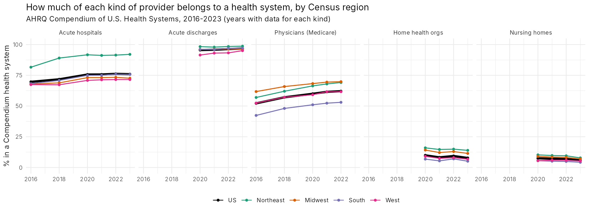
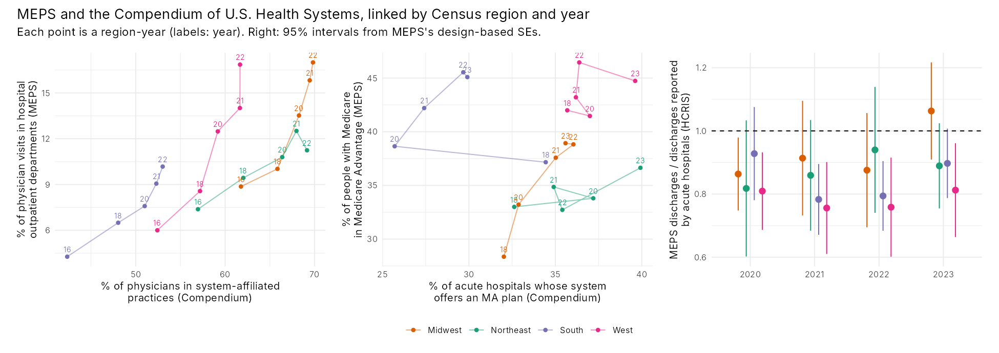

# What MEPS can and cannot tell you about hospitals, health systems, plans and facilities, and what AHRQ's Compendium of U.S. Health Systems adds

Eliot R. Weinstein · eliotw@uchicago.edu · erweinstein.com
7 November 2026; updated 8 November 2026 with the Compendium

MEPS is a survey of *people*. Its Household Component (HC) follows a sample of
the U.S. civilian noninstitutionalized population and records their care,
coverage and spending. Institutions (hospitals, plans, facilities) appear only
as the *places* where that care happened or the *payers* that covered it. No
public MEPS file names or identifies a specific hospital, health system, plan or
facility, and the only geography is the Census region.

AHRQ's **Compendium of U.S. Health Systems** (2016, 2018, 2020-2023) is the
other half of the picture: a list of every health system (at least one
non-federal general acute care hospital, at least 50 physicians and at least 10
primary care physicians under common ownership or management), with linkage
files that tie each system to its hospitals, group practices, nursing homes,
home health organizations and outpatient sites. It is about *institutions* and
has no patients in it.

Throughout this note, each fact is marked by where it comes from:
**[MEPS]** the public MEPS files alone; **[Compendium]** the Compendium alone;
**[linked]** both, joined by Census region and year (the only possible link).
The code is `R/14` to `R/17`; the MEPS figures for 2023 are reproduced by
`R/16` (section 5).

## 1. By institution type

| Institution type | [MEPS] alone | [Compendium] adds | Link to MEPS people? |
|---|---|---|---|
| **Hospitals** | As a setting, not by name. Inpatient stays (HC-248D: nights, whether the stay began in the ER, reason, surgery, payments by payer), outpatient department visits (HC-248F) and ER visits (HC-248E). In 2023 these three settings were 37.1% of all spending ($930 bn of $2.50 tn), 32.7% for the facility part alone; 6.4% of people had a stay. | Every U.S. hospital (6,800 in 2023), its system (if any), beds and discharges (from Medicare cost reports, HCRIS), teaching status, ownership. 75.9% of the 4,745 non-federal general acute hospitals were in a system in 2023 (69.7% in 2016), with 94% of their beds and 97% of their discharges: the 1,143 acute hospitals outside systems are small (median 25 beds), and 680 of them are critical access hospitals. | Region and year only. |
| **Health systems** (e.g., Banner Health, Intermountain Health), **medical centers** | No. No provider or system identifiers. | 639 systems in 2023 (626 in 2016), with counts of hospitals, physicians, nurse practitioners, nursing homes and home health organizations, and insurance products (section 2). | Region and year only. |
| **Physician practices** | As a setting: office-based visits (HC-248G) against hospital outpatient department visits (HC-248F). In 2023, 13.0% of physician visits were in hospital outpatient departments. | Every group practice billing Medicare, with its physicians (Medicare MD-PPAS counts) and system, if any: 62.1% of these physicians were in system-affiliated practices in 2022, up from 52.2% in 2016. | Region and year (section 3). |
| **Outpatient sites** (surgery centers, imaging, clinics) | No. | 283,138 sites in 2022 (IQVIA OneKey), 24.6% in systems (25.6% of surgery centers, 38.1% of imaging centers). | Region only (one year). |
| **Managed care organizations** (HMOs, Medicare Advantage, Medicaid managed care) | Partly: about 30 managed-care variables. In 2023, 42.2% of people with Medicare were in Medicare Advantage, 27.5% of Medicaid enrollees in a Medicaid HMO (household reports: CMS's county files put MA at 48.7% of Medicare eligibles in July 2023; section 3.3). The plan is not identified. | Which systems *own or offer* plans: 31.8% of systems had an insurance product in 2023, 24.0% an MA plan, 15.8% Medicaid managed care, 14.8% a marketplace plan. The 80 systems with MA contracts enrolled 4.35 million people; joined to CMS's county files by contract number, that is 13% of MA enrollees (29% in the West, 4% in the South). | Region and year (section 3), and, through CMS's files, by where enrollees live (section 3.3). |
| **ACOs** | No. | 2016: 55.6% of systems participated in at least one ACO contract. 2018: 58.4% had physicians in a Medicare ACO (162,000 physicians in all). Later years do not report ACOs. | Only by region, for 2016 and 2018, and MEPS has no ACO variable to relate it to. |
| **Long-term acute care hospitals (LTACHs)** | Essentially no: a stay would be an inpatient stay that cannot be told apart from others. | Identified by Medicare CCN: 360 LTACHs in 2023, 33% in systems. The share was 15-17% from 2016 to 2021; the jump in 2022 is almost all ScionHealth (launched in 2021 by LifePoint Health and Kindred Healthcare), which entered the Compendium with 48 LTACHs. Also 385 inpatient rehabilitation hospitals (24% in systems), 682 psychiatric (31%), 1,362 critical access (50%) and 101 children's (81%). | No. |
| **Skilled nursing facilities, nursing homes** | No. The HC covers people only while they are not in an institution, so institutional care is missing from MEPS spending. | 14,820 nursing homes in 2023: only 5.9% in Compendium systems, while 48.1% belong to a corporate (non-system) owner. | No: MEPS has no nursing home residents. |
| **Home health agencies** | As a setting: 4.4% of 2023 spending (agency and non-agency home health). | 12,809 home health, hospice and home dialysis organizations in 2023, 7.7% in systems. | Region and year only. |
| **VA, TRICARE, Indian Health Service** | As payers or coverage. | Federal hospitals are listed, mostly without a CCN (135 hospitals with "Veterans" or "VA" in the name in 2023, 8 of them in a system); systems are defined by non-federal hospitals. | No. |

## 2. Regions, and two named systems [Compendium]

The share of each kind of provider in a system, by Census region (2023; physicians 2022):

| | Acute hospitals | Acute beds | Acute discharges | Physicians (Medicare) | Nursing homes | Home health | Acute hospitals whose system offers MA |
|---|---|---|---|---|---|---|---|
| U.S. | 75.9% | 94.2% | 96.8% | 62.1% | 5.9% | 7.7% | 34.8% |
| Northeast | 92.0% | 98.2% | 98.7% | 69.2% | 7.8% | 13.9% | 39.9% |
| Midwest | 72.6% | 92.6% | 96.3% | 69.8% | 7.0% | 11.4% | 35.6% |
| South | 75.7% | 94.3% | 97.1% | 53.0% | 4.2% | 5.1% | 29.9% |
| West | 71.5% | 92.1% | 95.1% | 61.7% | 5.2% | 6.7% | 39.6% |

**Banner Health** (Phoenix): 33 hospitals in Arizona, California, Colorado,
Nebraska, Nevada and Wyoming in 2023, 5,258 beds, 244,680 discharges, 3,960
physicians, one nursing home and six home health organizations; it offers an
MA plan, with 24,089 enrollees (12,075 in 2018). **Intermountain Health** (Salt
Lake City; "Intermountain Healthcare" in the Compendium): 22-24 hospitals in
Utah and Idaho through 2021, then 33 hospitals in
Colorado, Idaho, Montana and Utah from 2022 (after its merger with SCL Health),
3,938 beds, 201,395 discharges, 3,903 physicians, 14 home health
organizations, and 51,536 MA enrollees in 2023. Neither can be found in MEPS: a
MEPS respondent in Arizona or Utah is known only to live in the West.

## 3. Linking MEPS to the Compendium [linked]

Because the only common key is the Census region, the link is **contextual**:
each MEPS person gets the characteristics of the health care system in their
region in that year. `R/16` does this for the MEPS full-year files of 2016 and
2018-2023 (2019 has no Compendium and is used only for the MEPS trends).

### 3.1 A benchmark: does MEPS see the hospital stays that hospitals report?

MEPS-estimated hospital discharges against the discharges non-federal general
acute hospitals report to CMS (HCRIS, in the hospital linkage file):

| Year | MEPS (millions) | Hospitals report (millions) | Ratio (95% interval) |
|---|---|---|---|
| 2020 | 25.2 | 28.9 | 0.87 (0.79-0.95) |
| 2021 | 24.4 | 29.7 | 0.82 (0.75-0.89) |
| 2022 | 24.6 | 29.6 | 0.83 (0.75-0.91) |
| 2023 | 27.5 | 30.1 | 0.91 (0.85-0.98) |

MEPS sees 82-91% of the discharges hospitals report, which is about what one
would expect: hospitals also discharge people MEPS does not cover (nursing home
residents, active-duty military, people who were institutionalized for the
whole year), and a transfer between hospitals is two discharges for the
hospitals. Regional ratios range from 0.76 to 1.06, with wide intervals
(`output/compendium/benchmark_discharges.csv`).

### 3.2 Two-level models with a regional system measure

For person *i* in region-year *j*, with *x* the person's age group, sex and
insurance, and *W* a Compendium measure for the region and year:

Level 1 (people):

  *y*ij = β0j + β1*x*ij + *e*ij

Level 2 (region-years):

  β0j = γ00 + γ01*W*j + (year effects) [+ (region effects)] + *u*0j

Combined:

  *y*ij = γ00 + γ01*W*j + β1*x*ij + (year) [+ (region)] + *u*0j + *e*ij

The "between" version has year effects only, so it compares regions with each
other in the same year; the "within" version adds region effects, so it uses
only how each region changed relative to the others. γ01 per 10
percentage points of *W*:

| Outcome [MEPS] | *W* [Compendium] | Region-years | Between | Within |
|---|---|---|---|---|
| % of a person's physician visits in hospital outpatient departments | % of physicians in system-affiliated practices (42-70%) | 20 | +2.4 points (1.3 to 3.5) | -9.9 points (-18.6 to -1.2) |
| Medicare Advantage, people with Medicare (log odds ratio) | % of acute hospitals whose system offers MA (26-40%) | 20 | -0.16 (-0.35 to 0.03) | -0.09 (-0.22 to 0.04) |
| Hospital spending per person ($) | % of acute hospitals in systems (67-92%) | 24 | +$103 (-$111 to $316) | -$61 (-$955 to $834) |

How to interpret these:

- **The pattern in the figure is real; an effect is not shown.** In every region,
  both the share of physicians in system-affiliated practices and the share of
  physician visits in hospital outpatient departments rose from 2016 to 2022
  (from 4-9% of visits to 10-17%), and regions with more integrated physicians
  had more outpatient-department visits in the same year (the "between"
  estimate). That is what vertical integration is expected to do when
  system-owned practices bill as hospital outpatient departments. But once each
  region is compared only with its own past (the "within" estimate), the sign
  reverses: the West's outpatient-department share jumped in 2020-2022 while its
  physician share barely moved. With four regions, these estimates rest on a few
  movements, and the model's intervals (which treat the cells as random and the
  measures as fixed) are too narrow. Neither estimate is evidence about what
  integration does.
- **Medicare Advantage and hospital spending show nothing** at this level.
- **Things that change at the same time as *W*** cannot be separated from it
  with 16-24 cells: MEPS's redesigned interview (2018 is the first full year
  collected with it, and AHRQ warns about trend analyses across the change),
  the 2020 pandemic, MA growth everywhere.

### 3.3 A better bridge for Medicare Advantage: CMS's county files [linked]

The Compendium lists each system's MA contract numbers. CMS publishes MA
enrollment by contract and county every month, and the share of Medicare
beneficiaries in MA by county (`R/18`, July of each year). Joining the two
places system-plan enrollees where they live, not where the system's hospitals
are, and CMS's penetration figures are an administrative benchmark for MEPS.

- **System plans by region.** In 2023, 13.0% of MA enrollees were in plans
  offered by Compendium systems: 28.8% in the West, 13.4% in the Northeast,
  12.7% in the Midwest and 4.1% in the South (2016: 15.0% nationally, 36.0% in
  the West; 2016 from CMS's abridged file). The county files account for 93-95%
  of the Compendium's national totals (CMS suppresses a contract's counts in
  counties with 10 or fewer enrollees).
- **MEPS against CMS.** MEPS's household reports of MA matched CMS's counts in
  2016 (ratio 0.87-1.06 by region) but fell behind as MA grew, especially in the
  Northeast and Midwest: in 2023 the ratios were 0.78 (Northeast), 0.79
  (Midwest), 0.92 (South) and 0.92 (West). (CMS's denominator is all Medicare
  eligibles; MEPS's is people reporting Medicare coverage, so some difference is
  expected.)
- **The two-level model with this measure** (24 region-years): 0.04 log odds
  per 10 points between regions (−0.02 to 0.10) and 0.09 within (−0.11 to
  0.29). Nothing, again.

### 3.4 What the link cannot do, and what would

- **No person-level or provider-level link.** The public files do not say which
  hospital or practice anyone used. So nothing in sections 3.1-3.2 can say
  whether patients of system hospitals spend more, get better care, or are in
  system-owned plans.
- **Finer geography is restricted.** MEPS's state and county identifiers are
  available only in restricted files (through AHRQ's data center or a Federal
  Statistical Research Data Center, under a separate agreement). With states,
  the same contextual models would have about 50 units per year instead of 4;
  with counties, the Compendium's hospital and site addresses could be matched
  to local markets.
- **The Medical Provider Component** (MPC) contacts the hospitals and doctors
  that MEPS respondents report, but its data are not public and are "not
  designed to yield national estimates" (HC-251 documentation).
- **For institution-level questions**, the Compendium links directly to other
  hospital data by CCN (Medicare cost reports, Hospital Compare, Provider of
  Services files) and to physician data by NPI and TIN, without MEPS.

Sources that would improve the crosswalk, and what each needs:

| Source | What it adds | Public? |
|---|---|---|
| CMS MA enrollment by state/county/contract, and MA state/county penetration (cms.gov) | System-plan enrollment where enrollees live; an administrative MA benchmark (used in `R/18`) | Yes |
| CMS Provider of Services file (data.cms.gov) | CCNs, addresses and types for hospitals missing them in the Compendium (used in `R/14` for 2016) | Yes |
| CMS Hospital Service Area file (data.cms.gov) | For each hospital (CCN), the ZIP codes its Medicare patients come from: local market shares of systems | Yes, but MEPS respondents' ZIP codes are not |
| Restricted MEPS: state, county and finer geography; the Medical Provider Component; the HC-Insurance Component linked file | Contextual models at the state or county level (about 50 states, or local markets, instead of 4 regions); provider-level detail | No: AHRQ's data center or an FSRDC, after a proposal and Special Sworn Status (6 months or more) |
| HCUP State Inpatient and Emergency Department Databases | Discharge records with AHA hospital identifiers in states that release them (an AHA linkage file exists for those), so system affiliation can be studied at the hospital level | Purchased; not MEPS people |
| AHRQ Social Determinants of Health Database | County, ZIP code and census tract measures, including health care context | Yes, but needs restricted MEPS geography to attach to people |

- **The machine learning chapters were not rerun with these measures.** A
  regional measure is constant within a region in a year, and the ML data set
  (2022 predictors, 2023 outcomes) already includes the region, so the regional
  measures cannot change any model's predictions.

## 4. Planning a trial that randomizes health systems [Compendium]

`R/17` uses the Compendium's 2023 system sizes to plan a cluster-randomized
trial of health systems. System sizes are very unequal: the coefficient of
variation of discharges per system is 2.35 (of primary care physicians, 2.12).
A trial of N = 3,000 patients in J randomly drawn systems, with patients
enrolled in proportion to discharges, has design effects (mean of 2,000 draws):

| ICC | J | Equal sizes | Eldridge et al. (2006), equal weighting of patients | Optimal weighting of clusters | Proportional enrollment, capped at 2× the mean, optimal weighting |
|---|---|---|---|---|---|
| 0.01 | 20 | 2.49 | 6.06 | 3.56 | 2.90 |
| 0.01 | 60 | 1.49 | 3.34 | 2.14 | 1.69 |
| 0.05 | 20 | 8.45 | 26.20 | 10.46 | 9.35 |
| 0.05 | 60 | 3.45 | 12.39 | 4.83 | 4.00 |

The Eldridge et al. formula,

  DE = 1 + ((cv² + 1) m̄ − 1) ρ,

with m̄ the mean cluster size and cv the coefficient of variation of the sizes,
applies when every patient is weighted equally. With real system sizes it
multiplies the design effect for equal clusters by 2.2 to 3.6. Weighting
clusters optimally (a mixed model, or cluster means weighted by
mj/(1 + (mj − 1)ρ)) recovers most of that loss (24-45%
more patients than equal clusters, against 112-259%). Capping enrollment at
twice the mean per system brings the extra to 11-18%. Planning such a trial
from equal cluster sizes would leave it badly underpowered. (`pilotplan`'s
cluster functions assume equal sizes; adding the cv is a natural extension.)

## 5. Files and reproducibility

- `R/14_compendium_extract.R`: reads the Compendium files (2016-2023) into
  stacked CSVs with Census regions and CCN-based hospital types.
- `R/15_compendium_profiles.R`: region × year profiles, hospital types,
  insurance products and ACOs, Banner and Intermountain, system sizes; the first
  figure.
- `R/16_meps_compendium_linkage.R`: the MEPS region × year estimates
  (design-based SEs), the discharge benchmark, the two-level models, and the
  2023 MEPS-only figures quoted in section 1; the second figure.
- `R/17_cluster_sizes_design_effect.R`: section 4.
- `R/18_cms_ma_crosswalk.R`: section 3.3 (needs CMS's public MA files).

The Compendium is public, but its files are large, so they and the tables made
from them stay out of the repository with the MEPS data. The two figures show
only regional aggregates.

**Sources:** MEPS HC-251 documentation (2023 Full Year Consolidated file),
sections on the Medical Provider Component and person eligibility; HC-209
documentation (2018), on the instrument redesign; MEPS full-year
files HC-192, HC-209, HC-216, HC-224, HC-233, HC-243 and HC-251 and event files
HC-248D-H (our tabulations, weighted by `PERWTyyF`, with design-based SEs);
AHRQ, *Compendium of U.S. Health Systems*, 2016, 2018, 2020, 2021, 2022 and 2023,
with the hospital, group practice, nursing home, home health and outpatient site
linkage files and their technical documentation (ahrq.gov/chsp); KFF, "Half of
All Eligible Medicare Beneficiaries Are Now Enrolled in Private Medicare
Advantage Plans" (2023; 30.2 million MA enrollees in January 2023); CMS,
Monthly MA Enrollment by State/County/Contract and MA State/County Penetration,
July 2016, 2018 and 2020-2023; CMS, Provider of Services File (Q4 2016); Eldridge,
S. M., D. Ashby and S. Kerry (2006), Sample size for cluster randomized trials:
effect of coefficient of variation of cluster size and analysis method,
*International Journal of Epidemiology* 35(5), 1292-1300; Rabe-Hesketh, S. and
A. Skrondal (2006), Multilevel modelling of complex survey data, *Journal of the
Royal Statistical Society, Series A* 169(4), 805-827.
